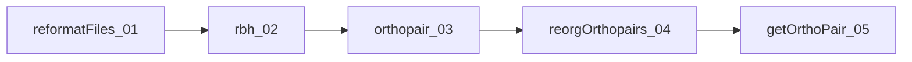
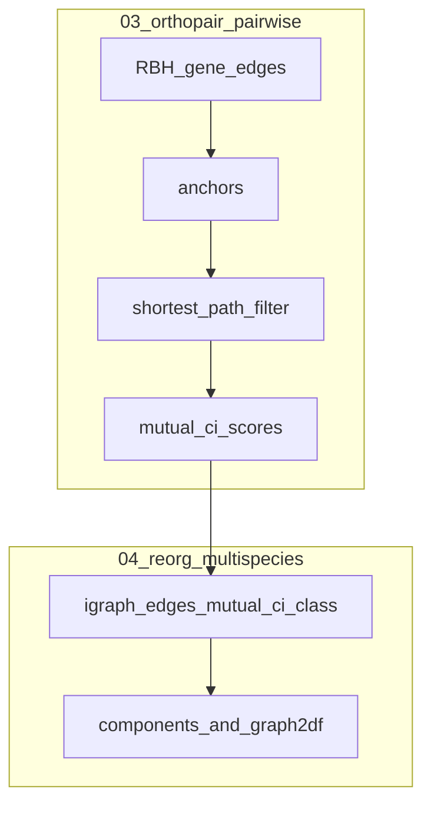

# 狭義／広義オーソログと RBH ネットワーク近似（OrthoPaiR 実装ベース）

## OrthoPaiR コア5ファイルに沿ったパイプライン

本パッケージの主系は次の順で繋がる（アルゴリズム本体は主に 02・03、多種まとめは 04、入出力補助は 01・05）。

| 段階 | ファイル | 役割 |
|------|----------|------|
| 入力正規化 | [/home/ftom/01_wd/softDevel/OrthoPaiR/R/01_functions_reformatFiles.R](/home/ftom/01_wd/softDevel/OrthoPaiR/R/01_functions_reformatFiles.R) | `reformatFiles()`：CSV検証、`working_dir/input/<index>_<name>/` 構成、ゲノム数上限 8999 など |
| 相同＋RBH | [/home/ftom/01_wd/softDevel/OrthoPaiR/R/02_functions_rbh.R](/home/ftom/01_wd/softDevel/OrthoPaiR/R/02_functions_rbh.R) | `rbh()`：BLAST ジョブ計画、`rbh/*.rbh` ペア別出力（`target_pair=NULL` 時は全無向ペア） |
| ペアワイズオーソログ | [/home/ftom/01_wd/softDevel/OrthoPaiR/R/03_functions_orthology.R](/home/ftom/01_wd/softDevel/OrthoPaiR/R/03_functions_orthology.R) | `orthopair()`（既定）: `.rbh` + `gff_df.rds` → `_findAnchors`（RBBH）→ `_findShortestPath`（C++ `rbh_shortest_path`：同一 chr ペア上の **gene_index L1 距離でアンカーへ最短**＝**シンテニー近似のオリジナル**）→ 分類・フィルタ。オプションで `.findSyntenicOrtho`（明示アンカー鎖） |
| 多種再編成・グラフ | [/home/ftom/01_wd/softDevel/OrthoPaiR/R/04_functions_reorgOrthopairs.R](/home/ftom/01_wd/softDevel/OrthoPaiR/R/04_functions_reorgOrthopairs.R) | `reorgOrthopairs()`：全ペアTSVを統合、GraphML（辺に `mutual_ci`, `class`）、`graph2df` で連結成分・大成分向けの列挙制御（`max_components`） |
| 結果読出し | [/home/ftom/01_wd/softDevel/OrthoPaiR/R/05_functions_IO.R](/home/ftom/01_wd/softDevel/OrthoPaiR/R/05_functions_IO.R) | `getOrthoPair()` 等：`orthopair/` または `reorg_out/pairwise/` から取得 |

注: **既定経路 `_findShortestPath` は「シンテニー非利用」ではない**。RBBH アンカーと共線染色体上の gene_index 順序（`rbh_shortest_path` の L1 距離）でシンテニー一貫性を取る**オリジナルアルゴリズム**。別系統として archive/05 由来の **明示アンカー鎖**（`_findSyntenicOrtho` + `.link2Anchor`）が `pairing_mode = "synteny"` でオプション利用可能。理論プラン・ベンチの前提は **オリジナル `shortest_path`** とする。

## 概念の対応（文献上の言い方）

- **狭義**: 2種の MRCA における相同で、種内重複や古い重複＋片系統欠失による**偽1対1**を除外したい運用。
- **広義**: より古い重複の後、各系統に残った**別パラログ**同士がペアで RBH 的に結ばれるケース。解析目的によっては許容または別ラベル化。

「広義＝常に悪」ではない。**分岐イベントの種類**が重要になる解析では区別が必要。

## 外部手法（ツリー・HOG）

調停、HOG（OMA / OrthoFinder 等）、外群を入れた4点一貫性は定義が明確。**コスト**が課題。

本パッケージですでに強いのは **02+03 のペア内 RBH＋GFF空間での制約**（アンカー、距離閾値、`mutual_ci`）。遠縁での pseudoortholog 抑制はここで相当部分を担う。

## 「RBH ネットワーク統計」＝ツリー近似を、既存コードのどこに載せるか

汎用 MCL 単体より、**OrthoPaiR 既存の二層**に載せるのが一貫する。

1. **ペア内層（03）**  
   既に `mutual_ci`, `pident`, アンカー距離、分類列がある。**第三ゲノムの BLAST 順位**や**種内上位ヒットとのスコア差**は、ペア処理の前後で **行メタデータ列**として足しやすい（`mutual_ci_min` や `pident_threshold_quantile` と同様のゲートにも使える）。

2. **多種グラフ層（04）**  
   `_createGraph()` は全ペア辺を `mutual_ci` と `class` 付きで統合済み。ここに **橋渡し遺伝子検出**、**成分内の辺重み一貫性**、**与えられた種系統トポロジーとの整合スコア**（完全四分子でなく、パス存在チェック程度）を **後段**として足すと、「RBH グラフを統計的に読む」方向と一致する。大成分は既に `max_components` で重い列挙を抑制する設計があるため、**追加解析も同様に閾値付き**が現実的。

3. **段階的エスカレーション**  
   03 または 04 で **フラグ**された遺伝子・辺だけ、高速木／調停へ送る（前プランの二段パイプライン）。

## アイデアの対応表（要約）

| アイデア | 主な載せ先 | 備考 |
|----------|------------|------|
| 種内 vs 種間スコア比 | 02 のヒット表拡張 → 03 で集約 | 全対全 BLAST が前提 |
| 4タクソン順位一貫性 | 03 行属性 or 04 辺の妥当性 | 外群1種でも効くことが多い |
| 近傍保存（多種） | 04 の辺クラスタ／将来は 03 に近傍列 | 03 は既定でアンカー+距離のシンテニー近似済み；明示鎖はオプション |
| Betweenness 等 | 04 `igraph` 後処理 | 単独では誤検知しやすい |

## 限界

RBH ネットワークだけでは in/out-paralog の**保証**は一般に不可能。**狭義らしさスコア**としてランキング・フラグ化が現実的。

## 参照の置き換え

本プランのコード根拠は **上記 01–05** とする。開発用スクリプト（`R/dev/*.R`）は挙動確認用の補助参照に留める。
