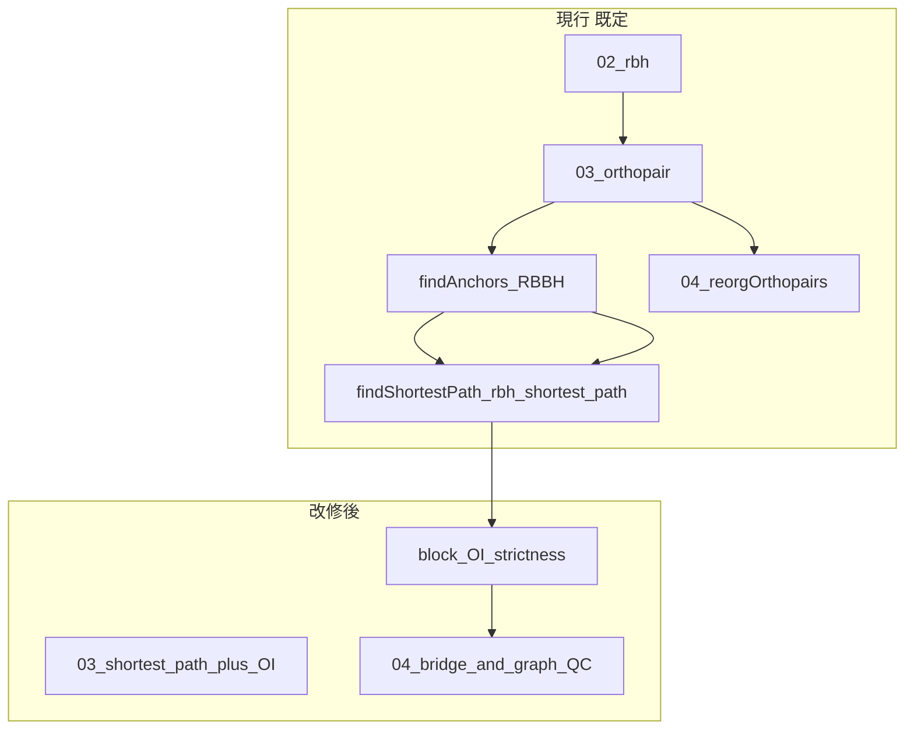
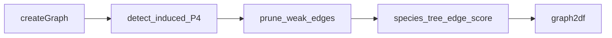

# OrthoPaiR アルゴリズム改修計画

## 関連ドキュメント

| ドキュメント | 内容 |
|-------------|------|
| [orthology_graph_heuristics_18901979.plan.md](./orthology_graph_heuristics_18901979.plan.md) | 問題設定・RBH グラフ近似の概念整理 |
| [algorithm_from_preprints.md](./algorithm_from_preprints.md) | プレプリント由来手法の適用検討・優先度 |

**作業ブランチ**: `aied`（想定）

---

## 1. 解くべき問題（スコープ）

| ID | 課題 | 成功基準（運用定義） |
|----|------|---------------------|
| Q1 | **pseudoortholog**（古い重複コピー同士の偽 1対1） | 遠縁2種ペアで 1対1 precision 向上；既知偽陽性セットで減少 |
| Q2 | **狭義 vs 広義**オーソログの区別 | 出力に `strictness` または `class` 拡張でラベル付与；下流がフィルタ可能 |
| Q3 | **多種**時の in/out-paralog 近似（フル遺伝子木なし） | `reorg_out` の誤マージ・矛盾辺が減る；任意種系統と整合 |

**スコープ外（本計画では実装しない）**

- OrthoFinder 級の全オーソグループ遺伝子木推定の本体組み込み
- SonicParanoid2 型 ML による BLAST 省略の新規学習
- 100–200 ゲノム向けの DIAMOND 全面置換（別イニシアチブ）

---

## 2. 現状アーキテクチャとギャップ

### 2.0 用語（03 ペアリング・04 多種拡張）

| 名称 | 実装 | 説明 |
|------|------|------|
| **`shortest_path`（唯一の経路）** | `.findAnchors` → C++ `rbh_shortest_path` → `.findShortestPath` | RBBH アンカー + 同一 (chr1, chr2) 上の gene_index **L1 距離**によるシンテニー近似（オリジナル）。 |
| **`bridge_inferred`（04）** | `.addBridgeInferredEdges` | 直接ペアに辺が無い (G1,G2) について、中間ゲノム Gb 上の 2-hop G1–Gb–G2 を推論（両脚 1to1・`bridge_score = pmin(mc1,mc2)`・既存辺と重複除去）。 |



| ファイル | 現状の強み | ギャップ |
|----------|------------|----------|
| [R/03_functions_orthology.R](/home/ftom/01_wd/softDevel/OrthoPaiR/R/03_functions_orthology.R) | **オリジナル**: RBH + RBBH アンカー + `rbh_shortest_path` によるシンテニー近似 + `mutual_ci` | 狭義／広義ラベル（`strictness`, OI）なし；明示アンカー鎖はオプションのみ |
| [R/04_functions_reorgOrthopairs.R](/home/ftom/01_wd/softDevel/OrthoPaiR/R/04_functions_reorgOrthopairs.R) | 全ペア `igraph`、colorful subgraph | 誤辺・P4 構造の事後検定なし |
| [R/05_functions_IO.R](/home/ftom/01_wd/softDevel/OrthoPaiR/R/05_functions_IO.R) | TSV 読出し | 新列の `score` オプション未対応 |
| [R/02_functions_rbh.R](/home/ftom/01_wd/softDevel/OrthoPaiR/R/02_functions_rbh.R) | ペア RBH | 種内 hit・第三種 transitive hit は未集約 |

---

## 3. 改修方針（設計原則）

1. **後方互換**: `orthopair()` はオリジナル `shortest_path` のみ。多種の見落とし回収は `reorgOrthopairs(infer_bridge_edges = TRUE)`（既定）。
2. **スコアは捨てない**: 除去ではなく **ランキング・フラグ**（`strictness`, `flag_pseudo`）を優先；閾値はユーザー調整可能。
3. **二層構造を維持**: ペア内精度は **03**、多種整合は **04**（プレプリント評価と一致）。
4. **検証可能**: 各 Phase 完了時に ablation 可能な中間 TSV を残す。
5. **reorg 北極星（2026-06、link_all 検証・cron 方針）**: pairwise グラフ上で OrthoFinder / Sonic が拾う BUSCO を **選択的 reorg**（bridge・augment・colorful subgraph・スコア閾値）で回収する。**link_all 型の連結成分全ペア展開は禁止**（recall は上がるがペア数 10⁶+・precision 悪化）。precision は低下させず **Sonic 超えが stretch**；ペア数は PW の数倍以内（詳細: `orthology/prior/cursor_dev/orthopair_revision_cycle/REORG_REVISION_POLICY.md`）。

---

## 4. Phase 0 — ベンチマークと baseline（実装前）

**目的**: 改修の効果を測る参照を固定する。

### 4.1 データセット

| セット | 用途 | 最低要件 |
|--------|------|----------|
| **D1** | 遠縁2種、ユーザー実績の改善が見えたペア | 手動または文献 50–200 遺伝子の 1対1 正解 |
| **D2** | 多種 3–8 ゲノム | OrthoFinder / SOI 参照 OG またはシミュレーション |
| **D3** | 回帰 | 既存 `R/dev/` または社内標準ペアで行数・`class` 分布が極端に崩れないこと |

### 4.2 指標

- **1対1 precision / recall**（D1）
- **偽陽性中の pseudoortholog 比率**（可能なら）
- **`mutual_ci` と誤判定の相関**
- **多種**: `orthopair_list.tsv` 行の precision vs 参照 OG（D2）
- **実行時間・メモリ**（03 ペアあたり、04 全体）

### 4.3 成果物

- `R/dev/benchmark_orthopair_revision.R`（または `tests/testthat/`）に baseline 実行スクリプト
- `working_dir/benchmark/baseline_metrics.tsv` を Phase 0 のコミットで固定

### 4.4 完了条件

- [ ] D1 の正解表が1系統以上ある
- [ ] 現行 `orthopair()` + `reorgOrthopairs()` の baseline 数値が記録済み

---

## 5. Phase 1 — ペア内改修（03 中心・最優先）

**文献根拠**: SOI Orthology Index（P2）、シンテニー phylogenomics（P10）、既存 archive/05 経路。

### 5.1 `orthopair()` API 拡張

**ファイル**: [R/03_functions_orthology.R](/home/ftom/01_wd/softDevel/OrthoPaiR/R/03_functions_orthology.R)

新パラメータ（案）:

```r
orthopair(
  ...
  pairing_mode = c("shortest_path", "synteny", "hybrid"),
  oi_threshold = 0.6,          # ブロック OI 閾値（SOI 既定に合わせる）
  strictness_filter = NULL,      # NULL | "strict" | "broad" — 出力フィルタ
  compute_block_oi = TRUE
)
```

| `pairing_mode` | 処理 |
|----------------|------|
| `shortest_path` | **オリジナル（既定）**: `.findAnchors` → `.findShortestPath`（内部で `rbh_shortest_path`）。シンテニーはアンカー位置と gene_index 順序で利用。 |
| `synteny` | **代替（明示アンカー鎖）**: `.findSyntenicOrtho` → `.findSyntenyBlocks`（`.link2Anchor` 必須）。オプション比較用。 |
| `hybrid` | 高 `mutual_ci` / アンカー RBH は **明示鎖**（`synteny` 側）；残りは **オリジナル**（`shortest_path`）。 |

**実装タスク**

- [x] `.runOrthopairPairingSelection()` に経路分岐を集約（旧コメントアウトブロックの置き換え）
- [x] `hybrid` の分岐: `is_anchor_pair | mutual_ci >= quantile` → 明示鎖、それ以外 → `shortest_path`
- [ ] `verbose` ログに使用モードを出力

### 5.2 Orthology Index（ブロック OI）

**定義（ペア内）**:

- シンテニーブロック（または synteny block ID）ごとに  
  `OI = (# ブロック内 RBH ペアで orthopair 候補と判定) / (# ブロック内共線遺伝子ペア)`
- 分子は `_findSyntenyBlocks`（`pairing_mode = synteny` / `hybrid` の一部）または、`shortest_path` ではアンカー・`mutual_ci` からの近似ラベル

**出力列（`orthopair/*.tsv`）**:

| 列名 | 型 | 説明 |
|------|-----|------|
| `synteny_block_id` | int | 既存または新規 |
| `block_oi` | numeric | [0,1] |
| `strictness` | char | `strict` / `broad` / `ambiguous` |
| `flag_pseudo` | logical | OI 低・距離異常・複数 RBH 競合などの合成 |

**`strictness` ルール（初期案・要校正）**:

| 条件 | `strictness` |
|------|----------------|
| `class == "1to1"` かつ `block_oi >= oi_threshold` かつ アンカー鎖上 | `strict` |
| `class == "1to1"` かつ `block_oi < oi_threshold` | `broad` |
| 複数同等 RBH・低 `mutual_ci` | `ambiguous` または `flag_pseudo = TRUE` |

**実装タスク**

- [ ] `.computeBlockOi(rbh_df, orthopair, g2g_graph)` ヘルパー追加
- [ ] `.assignStrictness(orthopair, oi_threshold)` 追加
- [ ] `_classifyOrthoPair` の後段で列を付与（分類ロジックは変更最小）

### 5.3 `class` の後方互換

- 既存 `class`（`1to1`, `1toM`, …）は **維持**
- 狭義 1対1 が必要な下流は `class == "1to1" & strictness == "strict"` を使用
- [R/05_functions_IO.R](/home/ftom/01_wd/softDevel/OrthoPaiR/R/05_functions_IO.R) の `score_col` に `block_oi`, `strictness`, `flag_pseudo` を追加

### 5.4 Phase 1 完了条件

- [ ] D1 で `pairing_mode = hybrid` + OI が baseline より precision 向上（目標: 相対 5–15% 以上、データ依存）
- [ ] 既定 `shortest_path` で D3 回帰が通る
- [ ] roxygen / man 更新

**想定工数**: 中（既存 synteny コードの整理が主）

---

## 6. Phase 2 — 多種グラフ改修（04 中心）

**文献根拠**: near-cograph（P1）、Proteinortho6 flooding（P3）、種系統一貫性（P6/P8）。

### 6.1 `reorgOrthopairs()` API 拡張

**ファイル**: [R/04_functions_reorgOrthopairs.R](/home/ftom/01_wd/softDevel/OrthoPaiR/R/04_functions_reorgOrthopairs.R)

新パラメータ（案）:

```r
reorgOrthopairs(
  ...
  graph_qc = c("none", "p4_flag", "prune_weak", "full"),
  weak_edge_quantile = 0.05,   # mutual_ci 下位削除
  species_tree = NULL,         # Newick または data.frame(edge)
  species_tree_penalty = 0.5   # 辺スコアへの減点重み
)
```

### 6.2 グラフ QC パイプライン

`_createGraph()` の直後、`.graph2df()` の前に挿入:



| ステップ | 内容 | 出力 |
|----------|------|------|
| **P4 検出** | 4 頂点・4 種の誘導 P4；辺の `mutual_ci` が低い対角を `flag_pseudo_edge` | 頂点属性または辺属性 |
| **弱辺 pruning** | 成分内 `mutual_ci` の下位 q% または Grubbs 的 outlier を削除（P3 flooding 簡易版） | 編集後 graph |
| **種系統スコア** | `species_tree` あり時、同一成分内で種間パスと矛盾する辺にペナルティ | `edge_tree_consistency` |

**実装タスク**

- [ ] `.detectP4Flags(graph, nm2g)` — `igraph` または成分内 brute force（頂点数上限で打ち切り）
- [ ] `.pruneWeakEdges(graph, quantile)` — 成分ごと
- [ ] `.scoreEdgesBySpeciesTree(graph, tree, nm2g)` — 任意
- [ ] `orthopair.graphml` に QC 属性を書き込み
- [ ] `orthopair_list.tsv` 生成時、`strictness == "strict"` の辺のみを使うオプション `use_strict_edges_only = FALSE`

### 6.3 Phase 2（任意）— 四分子 BLAST 一貫性

**前提**: 02 で第三ゲノム以上の RBH が `working_dir/rbh/` に存在。

- 03 で `flag_pseudo == TRUE` のペアのみ、4 種のベストヒット順位が種系統と両立するかチェック
- 結果を `quartet_consistent` 列として 03 TSV に追記（04 へ伝播）

**実装タスク**

- [ ] `.quartetConsistency(rbh_dir, pair_id, species_tree)` ヘルパー（02 読み込みのみ）
- [ ] `orthopair()` に `quartet_check = FALSE` オプション

### 6.4 Phase 2 完了条件

- [ ] D2 で誤マージ OG 行が減少、または P4 フラグ辺が参照 OG と相関
- [ ] `graph_qc = "none"` で現行と同一（回帰）
- [ ] 巨大成分で QC が `max_components` より先にメモリ・時間を抑える

**想定工数**: 中〜大

---

## 7. Phase 3 — エスカレーション（任意・別モジュール）

**目的**: フルパイプライン組み込みではなく、フラグ付き遺伝子だけ外部ツリーへ。

- 入力: `working_dir/orthopair/flag_pseudo_genes.tsv`（03/04 から出力）
- 出力: 調停後の `strictness` 上書き表
- 実装: `R/06_functions_escalation.R`（新規）またはドキュメント化された外部コマンドラッパのみ

**完了条件**: 10–50 遺伝子サブセットで手動検証可能

---

## 8. ファイル別変更一覧

| ファイル | Phase | 変更概要 |
|----------|-------|----------|
| `R/01_functions_reformatFiles.R` | — | 変更なし（種系統ファイルは任意で `input/species_tree.nwk` 等を慣例化するのみ） |
| `R/02_functions_rbh.R` | 2opt | 変更最小；四分子用に全ペア RBH 再利用のドキュメント |
| `R/03_functions_orthology.R` | 1, 2opt | `pairing_mode`, OI, strictness, quartet |
| `R/04_functions_reorgOrthopairs.R` | 2 | `graph_qc`, P4, pruning, species_tree |
| `R/05_functions_IO.R` | 1 | 新列の読み出し |
| `src/synteny.cpp`, `src/rbh.cpp` | 1? | 必要時のみ（R 側で足りれば触らない） |
| `man/*.Rd` | 1–2 | パラメータ・列説明 |
| `R/dev/benchmark_*.R` | 0 | 新規 |

---

## 9. 実装スケジュール（推奨順）

| 順 | タスク | 依存 |
|----|--------|------|
| 1 | Phase 0 baseline | — |
| 2 | Phase 1a `pairing_mode` + 明示鎖オプション | 0 |
| 3 | Phase 1b OI + strictness 列 | 1a |
| 4 | Phase 1c IO + ドキュメント | 1b |
| 5 | D1 評価・閾値校正 | 1c |
| 6 | Phase 2a P4 + weak prune | 1c |
| 7 | Phase 2b species_tree（任意） | 6 |
| 8 | Phase 2opt quartet | 2, 02 RBH |
| 9 | Phase 3 escalation（任意） | 5–7 |

---

## 10. リスクと緩和

| リスク | 影響 | 緩和 |
|--------|------|------|
| 明示鎖単独で recall 低下 | 真オーソログ欠落 | 既定はオリジナル `shortest_path`；比較は `hybrid` |
| OI 閾値 0.6 が系統で不適 | 誤 strict/broad | `oi_threshold` を暴露；D1 で校正 |
| P4 検出の計算量 | 大成分で遅延 | 頂点数上限・疑わしい成分のみ |
| 列追加による下流破壊 | 旧スクリプト | 既存列不変；新列はオプション読み出し |

---

## 11. 受け入れ基準（プロジェクト全体）

1. **Q1**: D1 で Phase 1 完了版の 1対1 precision が baseline を上回る。
2. **Q2**: 全 1対1 行に `strictness` が付与され、`strict` サブセットの precision が `broad` より高い（同じ D1）。
3. **Q3**: D2 で Phase 2 `graph_qc != "none"` が参照 OG に対し precision 向上、または P4 フラグが既知誤結合と一致。
4. **回帰**: `pairing_mode = "shortest_path"`, `graph_qc = "none"` で現行と実質同等（行数 ±許容範囲）。

---

## 12. 次のアクション

1. Phase 0 の D1 正解表の所在を確認（なければ最小カーブーションセットを作成）。
2. Phase 1a の `pairing_mode` ブランチを `aied` で実装開始。
3. 完了ごとに [algorithm_from_preprints.md](./algorithm_from_preprints.md) のマトリクスに「実装済／検証結果」列を追記（任意）。
