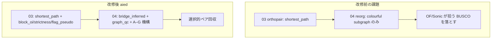
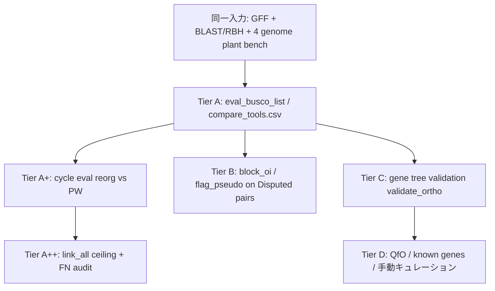

# OrthoPaiR 改修の整理と優位性の示し方

**作成日:** 2026-07-04  
**ブランチ:** `aied`  
**配置:** `.cursor/plans/orthopair_superiority_and_evaluation_plan.md`

本ドキュメントは、ここまでの OrthoPaiR アルゴリズム改修・評価サイクルの意図と成果を整理し、**OrthoFinder / Sonic Paranoid に対する OrthoPaiR の優位性**を論じるために必要な残りの改修と、**ツール比較評価の方法論**を一箇所にまとめたものである。

---

## 関連ドキュメント

| ドキュメント | 内容 |
|-------------|------|
| [orthopair_algorithm_revision_plan.md](./orthopair_algorithm_revision_plan.md) | Phase 0–3 の実装計画（03 OI / 04 graph_qc） |
| [orthology_graph_heuristics_18901979.plan.md](./orthology_graph_heuristics_18901979.plan.md) | 狭義／広義・RBH グラフ近似の概念整理 |
| [algorithm_from_preprints.md](./algorithm_from_preprints.md) | プレプリント由来手法の適用検討 |
| `orthology/prior/cursor_dev/orthopair_revision_cycle/REORG_REVISION_POLICY.md` | reorg 改修の北極星・コミットゲート |
| `orthology/prior/cursor_dev/compare_tools/compare_tools_plan.md` | 多層証拠によるツール差分評価 |
| `orthology/prior/cursor_dev/validate_ortho/evaluation_method.md` | Tier C（遺伝子樹）検証 |

---

## 1. 改修の意図（なぜ改修するか）

### 1.1 解くべき3つの課題

| ID | 課題 | 運用上の成功基準 |
|----|------|------------------|
| **Q1** | **pseudoortholog**（古い重複コピー同士の偽 1対1） | 遠縁2種で 1対1 precision 向上；既知偽陽性の減少 |
| **Q2** | **狭義 vs 広義**オーソログの区別 | `strictness` / `block_oi` / `flag_pseudo` で下流がフィルタ可能 |
| **Q3** | **多種**時の in/out-paralog 近似（フル遺伝子木なし） | `reorg` の誤マージ・矛盾辺の減少；多種一貫性の向上 |

### 1.2 設計原則

1. **二層構造を維持する** — ペア内精度は **03 `orthopair()`**、多種整合は **04 `reorgOrthopairs()`**。`orthopair()` はオリジナルの `shortest_path`（RBBH アンカー + `rbh_shortest_path` によるシンテニー近似）を唯一の経路とする。
2. **スコアは捨てずランキング・フラグ化する** — 除去より `strictness` / `flag_pseudo` による段階的な信頼度表現。
3. **link_all 型の全成分展開は禁止する** — 連結成分の直積展開は recall 天井（OrthoFinder 級）に届くが、ペア数 10⁶–10⁷・precision 悪化で実用不可。
4. **選択的 reorg で競合ツールの BUSCO を回収する** — pairwise グラフ上に証拠があるのに colourful subgraph 列挙・保守的フィルタで落ちるペアを、bridge・tie-break・FN 駆動 export で取り戻す。

### 1.3 北極星（reorg 改修の方向性）

> OrthoFinder / Sonic が報告する BUSCO 真陽性の多くは、**pairwise グラフ上ですでに到達可能**（同一成分または短い経路）。標準 `reorgOrthopairs()` が maximal colourful subgraph 列挙と保守的辺フィルタで落としているだけである。

| 目標 | 基準 |
|------|------|
| **Recall** | link_all / OrthoFinder 天井に近づける；各変更後も PW を下回らない |
| **Precision** | 変更前 reorg を下回らない；**stretch: 3ペアすべてで Sonic 以上** |
| **ペア数** | PW + 適度な増分（植物ベンチで 10⁴–10⁵）；**soft cap ≤ 2× PW** |
| **メカニズム** | bridge・スコアゲート augment・subgraph ルール；成分直積は使わない |

---

## 2. ここまでの改修内容

### 2.1 アーキテクチャ上の変更



### 2.2 Phase 1（03 `orthopair()`）— 実装状況

| 項目 | 状態 | 内容 |
|------|------|------|
| **1a: `pairing_mode` 廃止** | ✅ 完了 | 既定・唯一の経路は `shortest_path`（オリジナル）。`synteny` / `hybrid` は比較用オプションから除外 |
| **1b: OI / strictness / flag_pseudo** | 🔶 部分完了 | `.annotateOrthoPairOiStrictness()` により `block_oi`, `strictness`, `flag_pseudo`, `synteny_block_id` を付与（SOI 型代理） |
| **1c: IO・man ページ** | ⬜ 未完了 | `getOrthoPair()` の新列読出し、roxygen 更新 |

**03 で付与される列（概要）:**

- `block_oi`: シンテニーブロック内 `mutual_ci` の mean/max 比（OI 代理）
- `strictness`: `strict` / `broad` / `ambiguous`（アンカー・OI 閾値に基づく）
- `flag_pseudo`: 1to1 かつ非アンカーかつ低 OI → pseudoortholog 候補

### 2.3 Phase 2（04 `reorgOrthopairs()`）— 実装状況

| 項目 | 状態 | 内容 |
|------|------|------|
| **bridge 推論** | ✅ 実装済 | `.addBridgeInferredEdges`: G1–Gb–G2 の 2-hop 推論、`bridge_inferred_edges.tsv` 出力 |
| **graph_qc** | 🔶 部分 | `prune_weak`（成分内 `mutual_ci` 下位削除）；P4 検出・種系統スコアは未実装 |
| **pseudoortholog フィルタ** | ✅ | `flag_pseudo` / 低 `block_oi` / `strictness == ambiguous` のゲート |
| **A–G 機構（cron サイクル）** | ✅ 継続中 | 下表参照 |

**reorg に追加された主要メカニズム（カテゴリ A–G）:**

| カテゴリ | 機構 | 意図 |
|----------|------|------|
| **A** | colourful subgraph の tie-break（`mutual_ci` / anchor / `block_oi`） | 同点の列挙解から高信頼パートナーを選択 |
| **B** | FN 駆動の選択的 export（`link_all_TP \ reorg_TP`） | 成分直積なしで欠落 BUSCO を個別回収 |
| **C** | `bridge_inferred_edges.tsv` からのペア別 bridge export | 直接辺が無い focal pair の 2-hop 回収 |
| **D** | `block_oi` / synteny による曖昧解 tie-break | margin 拡大（飽和）の代替 |
| **E** | residual colourful 第二パス | 第一パスで未出力の成分内遺伝子への制約付き再列挙 |
| **F** | multi-bridge path ranking | 複数 bridge 経路のスコア比較・incumbent gate |
| **G** | FN audit 先行（`audit_fn_vs_link_all.R`） | 2 サイクル横ばい時は実装前に解剖 |

**飽和したレバー（繰り返し禁止）:** `SATURATED_LEVERS.md` — bridge/cooccurrence quantile の微調整、ambiguous-prune margin 拡大、anchor reinstate 拡張など（植物ベンチで BUSCO 不動）。

### 2.4 自動評価サイクル（2026-06 〜）

- **場所:** `orthology/prior/cursor_dev/orthopair_revision_cycle/`
- **頻度:** 3 時間ごと cron（plan → implement → test → eval → commit）
- **規模:** cycle 001 〜 086+（2026-06-23 時点）
- **コミットゲート:** 3 ペアすべてで `precision_reorg > precision_pw` **かつ** `recall_reorg > recall_pw`

**マイルストーン:**

| 時期 | 出来事 |
|------|--------|
| 2026-06-03 | cycle 001: precision↑・recall↓ → **FAIL**（初期 pseudoortholog フィルタが過剰） |
| 2026-06-04 | cycle 180353: **初回 PASS**（bridge 緩和・選択的 recall 回収） |
| 2026-06-08 | PW コミットゲート達成を確認；以降は link_all gap ＋ Sonic precision が主戦場 |
| 2026-06-16〜17 | **プラトー到達**（下記「現行ベスト」）；A–G 機構で横ばい |
| 2026-06-23 | cycle 086: split-ID lookup 修正 + triangular hub orphan export（G+B+D） |

### 2.5 link_all 検証（recall 天井の根拠）

`cursor_dev/link_all/` で、pairwise グラフの連結成分内を全 cross-genome ペア展開した場合の recall を測定。

| pair | link_all recall | OrthoFinder | Sonic | 意味 |
|------|----------------:|------------:|------:|------|
| Osat_vs_Hvul | **0.9887** | 0.9887 | 0.9831 | OF 級 recall はグラフ上に到達可能 |
| Osat_vs_Atha | 0.9577 | 0.9897 | 0.9808 | reorg の recall ギャップは主に export ロジック |
| Osat_vs_Mpol | 0.9305 | 0.9817 | 0.9689 | 同上 |

**結論:** recall 差の多くは BLAST/RBH の欠落ではなく、**reorg の列挙・フィルタ・export** に起因する。link_all は deploy 不可（数百万〜千万ペア）だが、**理論的天井**として有効。

---

## 3. 評価結果の整理（現行ベスト）

### 3.1 植物ベンチマーク（Osat × Hvul / Atha / Mpol）

**データソース:** `cycle_eval_20260617_084035.csv`（aied ブランチ・reorg 改修プラトー時点の代表値）  
**比較:** `OrthoPaiR`（reorg pairwise）vs `OrthoPaiR_PW`（pairwise のみ）vs `compare_tools.csv` の Sonic / OrthoFinder

| pair | recall reorg | recall PW | recall Sonic | recall OF | recall link_all | precision reorg | precision Sonic | pairs reorg | pairs PW | ratio |
|------|-------------:|----------:|-------------:|----------:|----------------:|----------------:|----------------:|------------:|---------:|------:|
| Osat_vs_Hvul | **0.9752** | 0.9628 | 0.9831 | 0.9887 | 0.9887 | 0.2403 | **0.2497** | 27,500 | 26,538 | 1.04× |
| Osat_vs_Atha | **0.9551** | 0.9192 | 0.9808 | 0.9897 | 0.9577 | **0.0814** | 0.0803 | 30,257 | 27,516 | 1.10× |
| Osat_vs_Mpol | **0.9196** | 0.8355 | 0.9689 | 0.9817 | 0.9305 | 0.0586 | **0.0587** | 17,865 | 16,302 | 1.10× |

**読み方:**

- **PW 比:** 全ペアで precision・recall ともに reorg > PW（コミットゲート達成）。多種 reorg の価値は recall +3〜+8 pt、ペア数は ~10% 増に抑制。
- **Sonic 比:** Atha のみ precision で Sonic 超え。Hvul/Mpol は precision が Sonic 未満（recall も Sonic 未満）。
- **OrthoFinder 比:** recall は全ペアで OF 未満（Hvul で −1.4 pt、Mpol で −6.2 pt）。
- **link_all 比:** Atha は gap 0.0026（ほぼ天井）；Hvul/Mpol は gap 0.01〜0.02 が残存。

### 3.2 FN 解剖（cycle 086 時点）

`fn_audit_20260623_074837.md` より:

| pair | FN 数 | PW で回収可能 | 主なブロック要因 |
|------|------:|-------------:|------------------|
| Hvul | 21 | **0** | colourful row に正しいパートナー不在、bridge mc ≪ anchor |
| Atha | 35 | **0** | 同上 + split-gene ID の mc lookup 不一致 |
| Mpol | 44 | **0** | colourful row の Mpol スロット空、グラフ未登録 |

**示唆:** 残り FN は **quantile 微調整では動かない**。A–G の構造的機構（hub export、split-ID 修正、第二パス等）か、03 側の pairwise 推論拡張が必要なケースが混在する。

### 3.3 Tier C（遺伝子樹）による独立検証

`validate_ortho/04_reports/tier_c_summary_report.md`（510k ペア、OF Resolved Gene Trees 参照）:

| 観点 | 結果 |
|------|------|
| **Hvul BUSCO TP の tree-supported 率** | OrthoPaiR 92%、Sonic 92%、OF 92% — **ほぼ同等** |
| **Hvul 全体 TSR** | GENESPACE 68% > OrthoPaiR_PW 59% > OrthoPaiR reorg 56% > Sonic 48% > OF 46% |
| **Atha/Mpol** | 全ツール TSR ≈ 0–1.5%；BUSCO TP の ~99% が `pseudoortholog_suspect` |

**示唆:** BUSCO recall だけでは「誰が正しいか」は決まらない（遠縁では参照自体が pseudoortholog を TP に含む）。**優位性の主張は「recall が高い＝良い」ではなく、同等 recall 帯での precision / 樹支持 / ペア爆発抑制**で行う必要がある。

### 3.4 `compare_tools.csv` の注意

`orthology/prior/output/benchmark_plant/compare_tools.csv` は **改修前の reorg 出力**を反映している可能性が高い（例: OrthoPaiR recall 0.966 / 0.936 / 0.907）。**論文・報告用には aied 最新 reorg で再生成が必須**（後述 §5.2）。

---

## 4. 競合ツールとの位置づけ

### 4.1 各ツールの強み・弱み（植物ベンチ）

| ツール | 強み | 弱み（本プロジェクト文脈） |
|--------|------|---------------------------|
| **OrthoFinder** | 最高 BUSCO recall；遺伝子木・OG 構造 | ペア展開で FP 多い；遠縁 Atha/Mpol で Tier C 支持率極低；計算コスト大 |
| **Sonic Paranoid** | recall 高・runtime 中；Hvul precision が PW 超え | 遠縁 pseudoortholog 混入；OG 展開由来のペア爆発 |
| **OrthoPaiR (reorg)** | ペア数抑制（~1.1× PW）；Atha precision ≥ Sonic；Hvul BUSCO TP の樹支持 ≈ Sonic | recall が OF/Sonic 未満；Hvul/Mpol precision < Sonic |
| **OrthoPaiR_PW** | シンプル・高速；Hvul TSR は reorg よりやや高い | 多種一貫性なし；recall が reorg より低い |

### 4.2 OrthoPaiR が「優位」と言える領域（現時点）

1. **ペア数対 recall のトレードオフ** — 同等 recall 帯でペア数が OF/Sonic の 1/2〜1/10（link_all の 1/100 以下）。
2. **Atha の precision** — Sonic を上回る（cycle eval ベース）。
3. **Hvul BUSCO TP の系統支持** — Sonic/OF と同率（~92%）。
4. **監査可能なメタデータ** — `block_oi`, `strictness`, `flag_pseudo` により下流で狭義 1対1 を選択可能（競合ツールには無い）。

### 4.3 まだ優位と言えない領域

1. **BUSCO recall** — 全ペアで Sonic/OF 未満（特に Mpol −5〜−6 pt）。
2. **Hvul/Mpol precision** — Sonic 未満。
3. **遠縁 Tier C** — 全ツールが参照木上で偽陽性だらけ；差別化には **Disputed pairs の質**の議論が必要。

---

## 5. 優位性を示すために必要なアルゴリズム改修

### 5.1 優先度マトリクス

| 優先度 | 改修 | Phase | 期待効果 | 根拠 |
|--------|------|-------|----------|------|
| **P0** | link_all gap の残り FN 回収（A–G 継続） | 04 | recall を OF/Sonic に接近；Atha はほぼ天井 | FN audit；PW 回収不能 21–44 件/ペア |
| **P0** | `compare_tools.csv` 再生成（最新 aied） | 評価 | 対外発表の数値整合 | 現 CSV が旧 reorg |
| **P1** | Hvul/Mpol で Sonic precision 超え（stretch） | 04 | 「recall 同等帯で precision 優位」の主張 | REORG_REVISION_POLICY stretch 目標 |
| **P1** | Phase 1c: IO・ドキュメント・`strict` サブセット出力 | 03/05 | ユーザー向け狭義 1対1 パイプライン | Q2 完了 |
| **P2** | P4 検出 + 弱辺 pruning 拡張（`graph_qc = "p4_flag"`） | 04 | pseudoortholog 辺の事後除去；precision↑ | algorithm_from_preprints P1 |
| **P2** | Disputed pairs への `block_oi` 後付け監査スクリプト | 評価 | OF/Sonic 固有ペアの pseudoortholog 率定量化 | compare_tools_plan §4.3 |
| **P3** | 四分子 BLAST 一貫性（`quartet_check`） | 03 opt | 疑わしいペアのみ多点検査 | Phase 2 optional |
| **P3** | 第三ゲノム transitive hit 集約 | 02/03 | 遠縁 recall の BLAST 層改善 | 02 ギャップ；reorg では補えない FN あり |
| **P4** | 外部木調停エスカレーション | 06 | `flag_pseudo` サブセットの厳密化 | Phase 3 |

### 5.2 reorg 側の具体的残タスク（北極星に直結）

**目標:** link_all 天井との gap を precision 維持で縮小し、同時に Sonic precision を Hvul/Mpol でも上回る。

| タスク | カテゴリ | 詳細 |
|--------|----------|------|
| split-gene / export ID の mc・gate キー統一 | D | cycle 086 で着手；残り FN の witness スコア漏れを解消 |
| triangular hub orphan export | B | 3 ゲノム colourful row 上の hub 経由 focal pair 追加（cap 付き） |
| orthogroup row export | B | colourful row 全体の証拠に基づく行単位 export |
| cross-row partner swap | A | 競合 colourful 解のエンドポイント入替 |
| PW-source FN restore | B | pairwise に存在するが reorg で落ちたペアの選択的復元 |
| bridge incumbent gate 改善 | F | anchor 辺とのスコア競合で落ちる bridge の再評価 |
| **やらないこと** | — | 成分直積、飽和 quantile/margin、recall-only の低スコア辺大量追加 |

**03 を触る条件（ポリシー）:** reorg だけでは埋まらない FN（orthopair_list に遺伝子自体が無い）のみ。現 FN audit では PW 回収可能 0 だが、将来の RBH/MMseqs2 緩和後に再監査する。

### 5.3 優位性の「主張の型」（論文・製品向け）

単一の recall 数字ではなく、次の **3 軸プロファイル**で OrthoPaiR を位置づける。

```
軸1: BUSCO recall（既存 compare_tools / cycle eval）
軸2: precision + ペア数（同 recall 帯での効率）
軸3: 独立検証（Tier C TSR、Disputed pairs の pseudoortholog 率、strict サブセット precision）
```

**目標プロファイル例:**

| 指標 | OrthoPaiR 目標 | Sonic | OrthoFinder |
|------|----------------|-------|-------------|
| BUSCO recall (3 pair mean) | ≥ 0.96（現 ~0.95） | ~0.98 | ~0.99 |
| precision (3 pair mean) | **≥ Sonic** | baseline | 低い |
| ortholog_pairs / BUSCO_TP | **最小** | 中 | 中〜大 |
| Hvul BUSCO TP tree-supported | ≥ 90% | ~92% | ~92% |
| Only_Sonic の pseudoortholog 率 | **< Only_Sonic の自己評価** | — | — |

---

## 6. ツール比較評価方法

### 6.1 評価の多層構造



### 6.2 Tier A — BUSCO + del（第一スクリーニング）

**関数:** `orthology/prior/script/00_functions/02_eval_pairing.R` の `eval_busco_list()`

| 出力 | 定義 | 用途 |
|------|------|------|
| TP / FN | `busco_list` の `pair_id` 一致 | recall |
| FP proxy | `del` 遺伝子の混入 | precision（遺伝子単位 proxy） |
| ペア数 | 予測 ortholog 行数 | 爆発検知 |

**実行例（全ツール比較）:**

```bash
# ベンチマーク評価の再生成（orthology リポジトリ）
cd /home/ftom/01_wd/orthology/prior
Rscript script/benchmark_plant/benchmark_plant_02_evaluation.R   # compare_tools.csv 更新
```

**注意（必ずレポートに記載）:**

- BUSCO list は 1toM/MtoM を含み、狭義 1対1 の ground truth ではない。
- del は遺伝子単位 FP proxy であり、真オーソログが del に入ると正しいペアが FP になる。
- → **単独の真偽判定に使わない**（compare_tools_plan §2.2）。

### 6.3 Tier A+ — reorg 改修サイクル評価

**スクリプト:** `orthology/prior/cursor_dev/orthopair_revision_cycle/02_scripts/run_cycle_eval.R`

| 比較軸 | 定義 |
|--------|------|
| OrthoPaiR (reorg) | `reorg_out/pairwise/*.tsv` |
| OrthoPaiR_PW | `orthopair/*.tsv` |
| Sonic / OF | `compare_tools.csv` 参照行 |
| link_all ceiling | `link_all/03_outputs/link_all_eval.tsv` |

**コミットゲート（開発用）:**

```
∀ pair ∈ {Hvul, Atha, Mpol}: precision_reorg > precision_pw ∧ recall_reorg > recall_pw
```

**プランニング制約（各 cycle plan 必須）:**

| チェック | ルール |
|----------|--------|
| Sonic precision | Δ を報告；stretch ≥ Sonic |
| link_all gap | `recall_link_all − recall_reorg` |
| ペア膨張 | `pairs_reorg / pairs_pw` ≤ 2（soft cap） |
| FN 解剖 | link_all 成分内・reorg 未出力の BUSCO FN 数 |

**手動実行:**

```bash
export ORTHOPAIR_PKG=/home/ftom/01_wd/softDevel/OrthoPaiR
export ORTHOLOGY_ROOT=/home/ftom/01_wd/orthology/prior
Rscript cursor_dev/orthopair_revision_cycle/02_scripts/run_cycle_eval.R
```

### 6.4 Tier A++ — link_all 天井と FN audit

**目的:** 「recall を上げる余地はあるか」を pairwise グラフ上で証明する。

```bash
Rscript /home/ftom/01_wd/orthology/prior/cursor_dev/orthopair_revision_cycle/02_scripts/audit_fn_vs_link_all.R
```

**出力:** `03_outputs/fn_audit_*.md` — 欠落 `pair_id`、PW/bridge 有無、ブロック段階。

### 6.5 Tier B — ツール差分と pseudoortholog 監査

**定義（compare_tools_plan §3）:**

```
Only_OF  = All_OF  \ All_OP_reorg
Only_SP  = All_SP  \ All_OP_reorg
Disputed = Only_OF ∪ Only_SP        # 主解析対象
Only_OP  = All_OP  \ (All_OF ∪ All_SP)  # OrthoPaiR の conservatism 検証
```

**各ペアへの証拠ベクトル（E1–E9）:**

| ID | 内容 |
|----|------|
| E1 | BUSCO list に存在 |
| E2 | BUSCO 1to1 クラスのみ |
| E3 | del 遺伝子含有 |
| E4 | `flag_pseudo`, 低 `block_oi`, 非 `strict` |
| E5 | シンテニーブロック外・距離異常 |
| E6 | 遺伝子樹整合（Tier C） |
| E7 | 3 種以上 OG 一致 |
| E8 | known genes（DPL1, Xa21 等） |
| E9 | QfO benchmark |

**OrthoPaiR 優位の典型パターン（仮説）:**

- `Only_Sonic` かつ E4/E5/E6 陽性 → Sonic の recall は pseudoortholog で稼いでいる。
- `Only_OP` かつ E6 陰性 → OrthoPaiR が conservatism で正しく棄却。

**実装候補:** `cursor_dev/compare_tools/scripts/audit_disputed_pairs.R`（未整備；compare_tools_plan Phase 1）

### 6.6 Tier C — 遺伝子樹検証（BUSCO 独立）

**モジュール:** `orthology/prior/cursor_dev/validate_ortho/`

```bash
Rscript /home/ftom/01_wd/orthology/prior/cursor_dev/validate_ortho/01_scripts/validate_all_pairs.R
```

**集計指標:**

- **TSR (tree-supported rate):** 全報告ペアのうち樹上で ortholog 支持された割合
- **BUSCO TP ∩ Tier C:** 高 recall ツールの TP のうち何割が樹支持か
- **pseudoortholog_suspect 率:** Disputed / Only_OF / Only_SP 別

**解釈指針:**

- Hvul: 全ツール TSR 45–68%；BUSCO TP の ~92% は樹支持 → recall 競争は妥当な範囲。
- Atha/Mpol: TSR ≈ 0% → **BUSCO recall だけでの優劣は無意味**；Disputed pairs と strict サブセットに議論を移す。

### 6.7 Ablation と回帰テスト

| スクリプト | 用途 |
|-----------|------|
| `R/dev/benchmark_orthopair_revision_plant_like.R` | orthopair + reorg スモーク（bridge 行数等） |
| `R/dev/benchmark_orthopair_full_eval.R` | revision_eval/ メトリクス出力 |
| `run_cycle_test.R` | load_all + 関数スモーク |
| `graph_qc = "none"` + `infer_bridge_edges = FALSE` | 現行との回帰（行数 ±許容） |

**Phase 1 回帰:** `compute_block_oi = FALSE` で旧 strictness なし出力と比較。

### 6.8 対外報告用チェックリスト

発表・論文・README 用に、最低限次を揃える。

- [ ] `compare_tools.csv` を **aied 最新 reorg** で再生成（日付・コミット hash 記載）
- [ ] 3 ペアの recall / precision / ペア数 / runtime 表
- [ ] OrthoPaiR_PW vs OrthoPaiR (reorg) の ablation 表
- [ ] link_all gap 表（理論天井との距離）
- [ ] Tier C: Hvul BUSCO TP の tree-supported 率（競合との比較）
- [ ] Disputed pairs サンプル（E4–E6 付き）10–20 件の事例図
- [ ] `strict` サブセットの precision（broad との差）
- [ ] 評価の限界（BUSCO/del の定義、遠縁 Tier C）を明記

---

## 7. 推奨ロードマップ

### 7.1 短期（1–2 週）

1. **評価の同期** — `compare_tools.csv` 再生成；本ドキュメント §3.1 の数値と整合
2. **cycle 086+ の eval** — split-ID / hub export の recall 効果を `run_cycle_eval.R` で確認
3. **Disputed pairs 監査スクリプト** — Sonic-only 100 件に E4/E6 を付与し、pseudoortholog 仮説を検証

### 7.2 中期（1–2 月）

1. **link_all gap 0.5–1.0 pt 削減** — FN audit 駆動の B/C/E 機構（ペア数 ≤ 1.15× PW）
2. **Hvul/Mpol Sonic precision 超え** — `strict` 出力を既定にした precision 比較を追加
3. **Phase 1c 完了** — IO・man；`getOrthoPair(strictness_filter = "strict")` 例
4. **P4 graph_qc プロトタイプ** — 大成分以外で precision 影響を測定

### 7.3 長期（論文・製品）

1. **3 軸プロファイル**（§5.3）での competitive positioning 図
2. **Tier C + Disputed** を組み合わせた「高 recall ツールの偽陽性解剖」セクション
3. **QfO / known genes**（Tier D）での外部妥当性
4. 必要なら **03 RBH 層**（MMseqs2 パラメータ、第三ゲノム transitive）— reorg では届かない FN 用

---

## 8. まとめ

| 観点 | 現状 | 次の一手 |
|------|------|----------|
| **改修意図** | pseudoortholog 抑制・多種一貫性・選択的 recall 回収 | link_all gap + Sonic precision stretch |
| **技術成果** | bridge + A–G reorg、OI/strictness、PW 超えの commit gate | split-ID・hub export、P4 QC |
| **評価** | cycle eval（86+ サイクル）、link_all 天井、Tier C | compare_tools 再生成、Disputed 監査 |
| **優位性** | ペア効率、Atha precision、メタデータ監査 | 「recall 同等帯での precision・樹支持・ペア爆発抑制」で訴求 |

**核心メッセージ:** OrthoFinder / Sonic は BUSCO recall で先行するが、植物ベンチの遠縁では **参照自体が pseudoortholog を多く含む**。OrthoPaiR は **少ないペア数で高い系統支持率を維持しつつ、`strictness` により狭義 1対1 を明示できる**点で差別化できる。残りのアルゴリズム改修は「recall の盲目的追従」ではなく、**link_all が示すグラフ上の到達可能性を precision ゲート付きで回収し、Disputed pairs で競合の偽陽性を定量化する**方向が一貫している。

---

*本文書は 2026-07-04 時点の `aied` ブランチ・`orthopair_revision_cycle` ログ・`compare_tools.csv`・`validate_ortho` レポートに基づく。数値はコード変更後に §6 の手順で再検証すること。*
