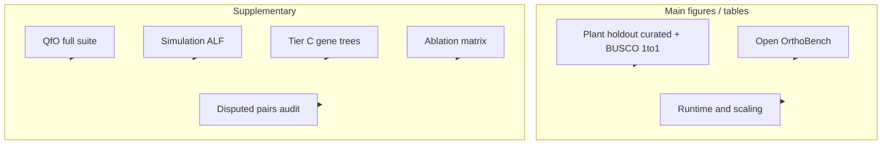

# 論文掲載に足るベンチマーク — 方針と実施手順

**作成日:** 2026-08-28  
**ブランチ:** `aied`  
**配置:** `.cursor/plans/publication_grade_benchmark_protocol.md`

本ドキュメントは、OrthoPaiR の性能を**査読付き論文で主張できる水準**まで評価するための方針と、実際の作業手順を定義する。方法論の背景は [orthology_benchmark_methods_2021_2026.md](./orthology_benchmark_methods_2021_2026.md)、改修文脈は [orthopair_superiority_and_evaluation_plan.md](./archive/orthopair_superiority_and_evaluation_plan.md) を参照。

---

## 1. 論文掲載に「足る」とは何か

### 1.1 最低要件（査読者が求めるもの）

| 要件 | 内容 |
|------|------|
| **再現性** | 入力 accession、ツール版、パラメータ、ハードウェア、評価コードが固定・公開されている |
| **独立性** | 開発中に見たデータと最終報告データが分離されている（holdout） |
| **比較の公平性** | 競合ツールは同一入力・同一 ID 規約・可能な限り同一 similarity search 条件 |
| **多層評価** | 単一の BUSCO recall だけでなく、複数の独立 proxy を併記 |
| **限界の明示** | 各指標が ground truth ではないこと、適用 taxon・relation class の偏りを Methods に記載 |
| **統計** | 信頼区間または bootstrap；巨大 family への過大重みを避ける |
| **Ablation** | 主張する機構（reorg、bridge、synteny、strictness 等）の寄与が分離されている |

### 1.2 本プロジェクトで採用する主張の型

**Primary claim（推奨）**

> 植物の WGD・遠縁比較において、OrthoPaiR（reorg）は、同等 recall 帯で **pseudoortholog を抑えた precision**、**moderate pair count**、**synteny/tree support**、および **計算資源効率** の Pareto 面で競合と比較可能、または優位である。

**Secondary claims（補助）**

- QfO 標準ベンチマーク上で Pareto frontier 上または近傍
- Open OrthoBench で orthogroup fission/fusion が抑制される
- `strict` サブセットの precision が `broad` より高い（confidence label の妥当性）
- Disputed pairs（Only_Sonic / Only_OF）に対し、独立証拠（Tier C / FAS）で偽陽性率が低い

**単独では論文主張に使わないもの**

- 開発用 `orthopair_revision_cycle` の commit gate のみ
- link_all recall 天井との gap 縮小のみ（link_all は deploy 不可）
- 1 系統・1 ペアのみの結果

---

## 2. 評価設計（事前登録）

### 2.1 データ分割

| 分割 | 用途 | 例 |
|------|------|-----|
| **Development (D)** | 閾値調整、FN audit、ablation 設計 | 既存 plant 4-genome bench + revision cycle |
| **Validation (V)** | 手法ファミリ選択、figure 下書き | V1a QfO plant dry-run；V1b local plant panel（8–12 spp）；ALF validation seeds |
| **Holdout (H)** | **論文 Table/Figure の最終数値** | 未使用 plant clade；simulation holdout seeds；curated set の未公開分 |

**ルール:** Holdout (H) は algorithm freeze 後に**1 回だけ**評価する。H で結果を見て再チューニングした場合、その数値は supplementary に回し、primary table は再 freeze 後の新 holdout で取り直す。

### 2.2 Primary / secondary endpoints（事前固定）

| 種別 | Endpoint | 数据集 |
|------|----------|--------|
| **Primary-1** | Pairwise precision–recall（curated positive/negative + BUSCO 1to1 層） | Plant holdout clade |
| **Primary-2** | Orthogroup F-score、exact recovery、fission rate | Open OrthoBench |
| **Primary-3** | End-to-end wall time & peak RSS（固定 hardware） | Plant 4-genome + scaling subset |
| **Secondary-1** | QfO Pareto 位置（STD, SwissTree, VGNC, FAS） | QfO 2022 Reference Proteomes |
| **Secondary-2** | Tree-supported rate（Tier C） | validate_ortho module |
| **Secondary-3** | Simulation PR under WGD + differential loss | ALF holdout seeds |

### 2.3 比較ツールと固定版

| Tool | 版の固定方法 | 出力モード |
|------|--------------|------------|
| **OrthoPaiR_PW** | git tag + commit hash on `aied` | `orthopair/` pairwise TSV |
| **OrthoPaiR** | 同上 | `reorg_out/pairwise/` |
| **OrthoPaiR_strict** | 同上 | `strictness == "strict"` のみ |
| **OrthoFinder** | 論文記載版（例: v2.5.4 または v3） | pairwise export + orthogroups |
| **SonicParanoid2** | 固定 commit + mode（default） | species-pair orthologs |
| **FastOMA** | 固定 release | QfO 提出形式 |
| **BBH/RBH baseline** | OrthoPaiR 02 相当 | 最小 baseline |

各ツールの **version string、Docker digest（または conda env export）、主要 CLI 引数** を `benchmark_manifest.yaml` に記録する。

### 2.4 ハードウェア・実行環境

論文用数値は**1 台の固定マシン**（または同一 VM スペック）で取得する。

| 項目 | 記録 |
|------|------|
| CPU モデル / コア数 | `lscpu` |
| RAM | `free -h` |
| OS | `uname -a` |
| R version | `R --version` |
| OrthoPaiR build | `packageVersion("OrthoPaiR")` + git hash |
| Thread 数 | 全ツール共通（例: 16） |
| Timeout | 例: 72 h / job |
| Memory limit | 例: 128 GB（OOM は fail として記録） |

---

## 3. ベンチマーク階層と論文での位置づけ



| Tier | 名称 | 論文での扱い | 根拠 |
|------|------|--------------|------|
| **A** | Plant holdout + curated labels | **Main** | 本ツールの主用途（植物 WGD）に直結 |
| **B** | Open OrthoBench | **Main** | Orthogroup 精度の community gold standard |
| **C** | Runtime / scaling | **Main** | 実用性 |
| **D** | QfO 2022 | **Supplementary** | 国際標準・競合直接比較 |
| **E** | Simulation (ALF) | **Supplementary** | 完全真値・failure mode |
| **F** | Tier C (gene trees) | **Supplementary** | BUSCO 独立の系統支持 |
| **G** | Disputed pairs + FAS | **Supplementary** | 高 recall 競合の偽陽性解剖 |

---

## 4. ディレクトリ構成と成果物

### 4.1 推奨レイアウト

```text
orthology/output/paper_benchmark_<YYYYMMDD>/
├── 00_manifest/
│   ├── benchmark_manifest.yaml      # 全バージョン・パラメータ
│   ├── endpoints_preregistration.md # 事前固定した primary/secondary
│   └── hardware.txt
├── 01_inputs/
│   ├── plant_holdout/               # GFF, genome, busco, del, curated labels
│   ├── qfo_2022/                    # QfO reference proteomes（シンボリックリンク可）
│   └── orthobench/                  # Open_Orthobench clone
├── 02_predictions/
│   ├── orthopair_pw/
│   ├── orthopair_reorg/
│   ├── orthopair_strict/
│   ├── orthofinder/
│   ├── sonicparanoid2/
│   └── fastoma/
├── 03_evaluations/
│   ├── plant_holdout_metrics.tsv
│   ├── orthobench_metrics.tsv
│   ├── qfo_submission/              # OpenEBench 結果 CSV
│   ├── simulation_metrics.tsv
│   ├── tier_c_summary.tsv
│   └── runtime_summary.tsv
├── 04_figures/
└── 05_archive/
    ├── predictions.tar.zst          # 再現用
    └── eval_scripts.tar.zst
```

OrthoPaiR 側の実行用 working_dir 例:

```text
/home/ftom/01_wd/orthology/prior/output/benchmark_plant/orthopair/
```

---

## 5. 実施手順（フェーズ別）

### Phase 0 — 事前固定（1–2 日） ✅ 2026-08-28 完了

**目的:** 論文数値の「設計書」を freeze する。

**成果物ディレクトリ:** `/home/ftom/01_wd/orthology/paper_benchmark_20260828/`（[README](file:///home/ftom/01_wd/orthology/paper_benchmark_20260828/README.md)）

1. 本ドキュメント §2 の primary/secondary endpoints をコピーし、`endpoints_preregistration.md` として日付・担当者とともに保存。 → `00_manifest/endpoints_preregistration.md`
2. `benchmark_manifest.yaml` を作成: → `00_manifest/benchmark_manifest.yaml`

```yaml
study_id: orthopair_paper_benchmark_2026
orthopair:
  repo: /home/ftom/01_wd/softDevel/OrthoPaiR
  branch: aied
  commit: <git rev-parse HEAD>
  tag: paper-bench-v1          # freeze 時に打つ
competitors:
  orthofinder:
    version: "2.5.4"
    docker: null
  sonicparanoid2:
    version: "2.0.4"
    mode: default
hardware:
  hostname: <hostname>
  threads: 16
  memory_limit_gb: 128
holdout:
  plant_clade: <define>
  simulation_seeds: [1001, 1002, 1003, 1004, 1005]
```

3. Holdout データの正例・負例定義書を作成（§5.4 参照）。 → `01_inputs/plant_holdout/00_schema/holdout_label_schema.md`  
   **Holdout clade 固定:** Bdis (GCF_000005505.3) + Gmax + Ptri；pairs: Bdis_vs_Gmax, Bdis_vs_Ptri（[data_split_registry.md](file:///home/ftom/01_wd/orthology/paper_benchmark_20260828/00_manifest/data_split_registry.md)）
4. 開発 set では触らないよう、Holdout ディレクトリへ read-only 権限を設定（運用ルール）。 → `00_schema/` read-only；ラベル freeze 用 `scripts/lock_holdout_labels.sh`（[HOLDOUT_ACCESS_POLICY.md](file:///home/ftom/01_wd/orthology/paper_benchmark_20260828/00_manifest/HOLDOUT_ACCESS_POLICY.md)）

**完了条件:** manifest + preregistration + holdout label schema が commit または Zenodo draft 済み。  
**未了:** git tag `paper-bench-v1`、holdout raw inputs、curated labels（Phase 2.4）

---

### Phase 1 — 植物 4 ゲノム・パイプライン実行（2–5 日）

**目的:** OrthoPaiR_PW / OrthoPaiR reorg の予測を最新 `aied` で生成する。

#### 1.1 入力確認

```bash
BENCH=/home/ftom/01_wd/orthology/prior/output/benchmark_plant/orthopair
ls "$BENCH/input/"*/gff_df.rds
ls "$BENCH/rbh/"*.rbh 2>/dev/null | head
```

必要: Osat, Hvul, Atha, Mpol の `reformatFiles` 済み `input/`、`rbh/`（または再計算方針）。

#### 1.2 OrthoPaiR 実行

```bash
export ORTHOPAIR_PKG=/home/ftom/01_wd/softDevel/OrthoPaiR
cd "$ORTHOPAIR_PKG"

Rscript R/dev/benchmark_orthopair_revision_plant_like.R \
  "$BENCH" \
  "$ORTHOPAIR_PKG"
```

出力:

- `$BENCH/orthopair/*.tsv` — PW
- `$BENCH/reorg_out/pairwise/*.tsv` — reorg
- `$BENCH/reorg_out/bridge_inferred_edges.tsv`

#### 1.3 予測のスナップショット

```bash
PAPER=orthology/output/paper_benchmark_$(date +%Y%m%d)
mkdir -p "$PAPER/02_predictions/orthopair_pw" "$PAPER/02_predictions/orthopair_reorg"
cp -a "$BENCH/orthopair/"*.tsv "$PAPER/02_predictions/orthopair_pw/"
cp -a "$BENCH/reorg_out/pairwise/"*.tsv "$PAPER/02_predictions/orthopair_reorg/"
```

#### 1.4 Strict サブセットの抽出

`strictness == "strict"` かつ `class == "1to1"` の行のみを論文用 `OrthoPaiR_strict` として別 TSV に書き出す（評価スクリプト Phase 2 で実装、または ad hoc R）。

**完了条件:** 3 pair × 2 モード（PW, reorg）の TSV が paper ディレクトリにコピー済み。

---

### Phase 2 — 植物ベンチマーク評価（1–3 日）

**目的:** `compare_tools.csv` 相当を**最新 reorg**で再生成し、さらに holdout curated 評価を追加。

#### 2.1 既存 BUSCO 評価の再実行

```bash
cd /home/ftom/01_wd/orthology/prior
# benchmark_plant_02_evaluation.R の root_dir / wd を環境に合わせて修正
Rscript script/benchmark_plant/benchmark_plant_02_evaluation.R
```

出力: `prior/output/benchmark_plant/compare_tools.csv`

**Methods に必ず記載:**

- TP/FN: `busco_list` の `pair_id` 一致（ペア単位）
- FP proxy: `del` リスト遺伝子の混入（**遺伝子単位**；ペアの pseudoortholog 直接ラベルではない）
- BUSCO list は 1toM/MtoM を含む

#### 2.2 クラス別（1to1 のみ）の再集計

`eval_busco_list()` は `TP_1to1_rate` 等を返す。論文 Table には **全体** と **BL_1to1 のみ** の両方を載せる。

```r
source("prior/script/00_functions/02_eval_pairing.R")
# og, busco_list, del を読み込み
res_all <- eval_busco_list(og, busco_list, del)
busco_11 <- subset(busco_list, class == "1to1")
res_11  <- eval_busco_list(og, busco_11, del)
```

#### 2.3 Ablation（同一入力）

| Run ID | orthopair | reorg | infer_bridge | graph_qc | 出力先 |
|--------|-----------|-------|--------------|----------|--------|
| A0 | default | — | — | — | PW baseline |
| A1 | default | default | TRUE | prune_weak | reorg full |
| A2 | default | default | FALSE | prune_weak | reorg no-bridge |
| A3 | default | default | TRUE | none | reorg no-qc |

各 run で Phase 1–2.1 を繰り返し、Primary endpoint への寄与を Table にまとめる。

#### 2.4 Holdout curated 評価（Main figure 用）

Holdout 正例・負例セット（TSV）:

```text
pair_id, query, subject, label, evidence, relation_class
Osat_xxx_Hvul_yyy, Osat_xxx, Hvul_yyy, positive, gene_tree, 1to1
...
```

評価:

```r
pred$pair_id <- paste(pred$query, pred$subject, sep = "_")
tp <- sum(pred$pair_id %in% pos$pair_id)
fp <- sum(pred$pair_id %in% neg$pair_id)
fn <- sum(!pos$pair_id %in% pred$pair_id)
# precision = tp / (tp + fp); recall = tp / (tp + fn)
```

**層別化:** 近縁 / 遠縁 / WGD-affected / pseudoortholog-curated negative。

**統計:** gene family または BUSCO OG を cluster とした bootstrap 95% CI。

**完了条件:** `plant_holdout_metrics.tsv` + ablation table + 更新 `compare_tools.csv`。

---

### Phase 3 — Open OrthoBench（1–2 日）

**目的:** Orthogroup レベルの Main table を得る。

#### 3.1 データ取得

```bash
git clone https://github.com/davidemms/Open_Orthobench.git \
  orthology/output/paper_benchmark_*/01_inputs/orthobench
cd orthobench/BENCHMARKS
ls RefOGs/ Input/
```

#### 3.2 OrthoPaiR で 12 proteomes を処理

Open OrthoBench の 12 input proteomes に対し OrthoFinder 相当の orthogroup 出力形式（TSV）を得る。OrthoPaiR が直接 RefOG 形式を出さない場合:

- `reorg_out/orthopair_list.tsv` から species×gene の group を構築、または
- 12 種のみの multi-species `reorgOrthopairs()` run を別 working_dir で実行

#### 3.3 評価

```bash
cd orthobench/BENCHMARKS
python3 benchmark.py <path_to_predicted_orthogroups.tsv> > orthobench_results.txt
```

記録する指標: precision, recall, F-score, exact OG count, missing genes, fission/fusion（スクリプト出力に従う）。

競合（OrthoFinder, SonicParanoid2 等）も**同一 12 proteomes**で実行。

**完了条件:** `orthobench_metrics.tsv`（tool × metric）。

---

### Phase 4 — QfO 標準ベンチマーク（3–7 日）

**目的:** Supplementary で国際標準比較。

#### 4.1 Reference proteomes

- ダウンロード: [QfO 2022 release](https://ftp.ebi.ac.uk/pub/databases/reference_proteomes/previous_releases/qfo_release-2022_02_with_updated_UP000000437/)
- **重要:** UniProt から個別に取った FASTA は ID がずれる。必ず QfO 公式 tar を使う。

#### 4.2 OrthoPaiR 予測 → pair 抽出

78 種全体に対し RBH + orthopair + reorg は計算コスト大。論文用には:

1. まず **pairwise ortholog pairs** を UniProt accession の TSV に変換
2. OrthoXML v0.3 への変換（将来の group benchmark 用に推奨）

変換ルールは QfO ドキュメントに従う: https://orthology.benchmarkservice.org/proxy/doc

#### 4.3 OpenEBench 提出

1. https://orthology.benchmarkservice.org/ → Submit Predictions → QfO 2022
2. 全 benchmark または論文で報告する subset を選択
3. 結果 CSV を `03_evaluations/qfo_submission/` に保存

#### 4.4 報告形式

- 各 test について precision proxy vs recall proxy の scatter
- Pareto frontier 上の位置を記述（単一順位は付けない）
- OrthoFinder, SonicParanoid2, FastOMA の public results と同一 proteome set で比較

**完了条件:** QfO 8 種類の試験結果 PDF/CSV + 自ツールの Pareto プロット。

---

### Phase 5 — Simulation（ALF）（3–5 日）

**目的:** WGD + pseudoortholog の完全真値評価（Supplementary）。

#### 5.1 シナリオ（holdout seeds 固定）

| Scenario | 設定 |
|----------|------|
| S1 | single-copy, rate gradient |
| S2 | small-scale dup/loss |
| S3 | WGD + differential loss（pseudoortholog 生成） |
| S4 | synteny decay（rearrangement パラメータ sweep） |

参考: Natsidis et al. 2021（ALF, 57 spp, 5000 genes）— [DOI 10.1016/j.isci.2021.102110](https://doi.org/10.1016/j.isci.2021.102110)

#### 5.2 実行フロー

1. ALF で genome/proteome 生成
2. `reformatFiles` → `rbh` → `orthopair` → `reorgOrthopairs`
3. 真の ortholog pairs / orthogroups と TP/FP/FN

#### 5.3 報告

- scenario × tool の precision/recall/F1
- pseudoortholog rate vs evolutionary rate の関係
- 下流 gain/loss への影響（optional）

**完了条件:** `simulation_metrics.tsv` + 少なくとも 1  figure（PR curve or barplot）。

---

### Phase 6 — Tier C 遺伝子樹検証（2–4 日）

**目的:** BUSCO 独立の系統支持（Supplementary）。

既存モジュール: `orthology/prior/cursor_dev/validate_ortho/`

```bash
cd /home/ftom/01_wd/orthology/prior
Rscript cursor_dev/validate_ortho/01_scripts/validate_all_pairs.R
# 出力: 03_outputs/summary/tier_c_by_tool.csv
```

**解釈注意（Methods 必須）:**

- Tier C は ground truth ではない
- 遠縁（Atha/Mpol）では全ツール TSR ≈ 0 に近い → **Hvul 近縁と holdout を主に報告**

Disputed pairs（Only_Sonic, Only_OF, Only_OP）の Tier C / FAS 分布を supplementary table に。

---

### Phase 7 — Runtime & scaling（1–2 日）

**目的:** Main table の実用性列。

#### 7.1 固定条件

```bash
# 例: hyperfine + memory_profiler（SonicParanoid2 論文と同様）
hyperfine --warmup 1 --runs 3 \
  'Rscript run_orthopair_bench.R' \
  --export-json runtime_plant4.json
```

記録: wall time, peak RSS, disk peak, completion（timeout/OOM 記録）。

#### 7.2 Scaling subset

種数を 4 → 8 → 16 → 32 と増やした QfO subset または plant subset で log–log plot。

**完了条件:** `runtime_summary.tsv` + scaling figure。

---

### Phase 8 — 統合・論文原稿用アウトプット（2–3 日）

#### 8.1 Main tables（案）

| Table | 内容 |
|-------|------|
| **Table 1** | Datasets, species, accession, evaluation tiers |
| **Table 2** | Plant holdout: precision/recall/F1/MCC（全体 + 1to1）、pair count、95% CI |
| **Table 3** | Open OrthoBench: P/R/F1, exact, fission, fusion |
| **Table 4** | Runtime & memory（4-genome + scaling exponent） |

#### 8.2 Main figures（案）

| Figure | 内容 |
|--------|------|
| **Fig 1** | OrthoPaiR pipeline + evaluation tiers schematic |
| **Fig 2** | Plant holdout PR curve（PW vs reorg vs OF vs Sonic） |
| **Fig 3** | OrthoBench F-score comparison |
| **Fig 4** | Ablation（bridge, graph_qc, strictness） |
| **Fig 5** | Runtime vs accuracy Pareto |

#### 8.3 Supplementary

- 全 QfO test 結果
- Simulation 全 scenario
- Tier C cross-tabulation
- Disputed pairs 事例（10–20 pair）
- `compare_tools.csv` 全文（BUSCO + del）
- `benchmark_manifest.yaml`

#### 8.4 Methods 必須段落（チェックリスト）

- [ ] BUSCO list / del list の定義と限界（`eval_process_audit.md` 参照）
- [ ] pairwise vs orthogroup 評価単位の区別
- [ ] STD RF は topological concordance proxy であること
- [ ] Holdout 分割と algorithm freeze のタイミング
- [ ] 競合ツール version と mode
- [ ] OrthoPaiR `shortest_path` + `reorg` の二層構造
- [ ] 統計単位（family-cluster bootstrap）

---

## 6. 品質ゲート（論文投稿前）

以下をすべて満たすまで primary claim を出さない。

| # | ゲート | 基準 |
|---|--------|------|
| G1 | Reproducibility | 第三者が manifest から主要 figure 1 つを再計算できる |
| G2 | Holdout integrity | Holdout ラベルが development 中に未使用 |
| G3 | Fair comparison | 競合と入力 accession / ID 規約が一致 |
| G4 | Multi-tier | Main に A+B+C の 3 tier 以上 |
| G5 | Ablation | reorg の主張に対応する ≥2 ablation |
| G6 | Statistics | Primary endpoint に 95% CI |
| G7 | Limitations | Methods に proxy 指標の限界を明記 |
| G8 | No overclaim | BUSCO recall のみで「OrthoFinder 超え」と書かない（除非 holdout curated + Tier C で支持） |

---

## 7. タイムライン（目安）

| Week | 内容 |
|------|------|
| W1 | Phase 0–1: preregistration, plant pipeline, snapshot |
| W2 | Phase 2–3: plant eval + OrthoBench |
| W3 | Phase 4: QfO submission |
| W4 | Phase 5–6: simulation + Tier C |
| W5 | Phase 7–8: runtime, figures, Methods draft |
| W6 | Internal review, holdout re-check, Zenodo archive |

---

## 8. 既存資産との対応

| 既存 | 本 protocol での位置づけ |
|------|-------------------------|
| `script/benchmark_plant/benchmark_plant_02_evaluation.R` | Phase 2.1（開発 set；論文用は再実行必須） |
| `R/dev/benchmark_orthopair_revision_plant_like.R` | Phase 1.2 |
| `cursor_dev/orthopair_revision_cycle/run_cycle_eval.R` | Development only；論文数値にしない |
| `cursor_dev/validate_ortho/` | Phase 6 |
| `cursor_dev/link_all/` | Recall ceiling 参考；論文主張にしない |
| `compare_tools.csv`（旧 reorg） | **差し替え必須** |

---

## 9. 関連ドキュメント

| ドキュメント | 内容 |
|-------------|------|
| [orthology_benchmark_methods_2021_2026.md](./orthology_benchmark_methods_2021_2026.md) | 2021–2026 文献調査・方法分類 |
| [orthopair_superiority_and_evaluation_plan.md](./archive/orthopair_superiority_and_evaluation_plan.md) | 改修意図・競合比較の論点 |
| [orthopair_algorithm_revision_plan.md](./archive/orthopair_algorithm_revision_plan.md) | アルゴリズム Phase 計画（アーカイブ） |
| `orthology/prior/cursor_dev/compare_tools/compare_tools_plan.md` | Disputed pairs・証拠ベクトル E1–E9 |
| `orthology/prior/cursor_dev/eval_process_audit.md` | BUSCO/del 評価の監査 |
| `orthology/prior/cursor_dev/validate_ortho/evaluation_method.md` | Tier C 手順 |

---

## 10. 次のアクション（着手順）

1. ~~**`benchmark_manifest.yaml` と holdout label schema を作成**（Phase 0）~~ ✅
2. **`aied` を tag `paper-bench-v1` で freeze**
3. **Phase 1–2 を実行し `compare_tools.csv` を最新 reorg で上書き**
4. **Holdout curated set の正例 50–200 pair を gene tree + synteny で作成**
5. **Open OrthoBench と QfO を parallel で進める**

論文の Main claim は Phase 2（holdout）+ Phase 3（OrthoBench）+ Phase 7（runtime）が揃ってから確定する。
