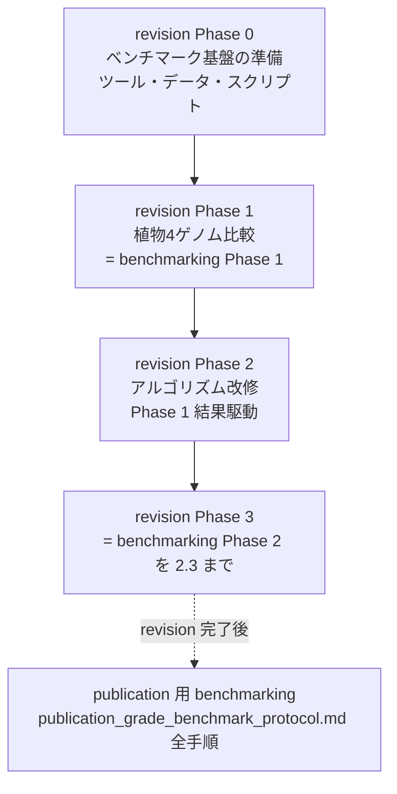

# OrthoPaiR リビジョン計画（正本）

**作成日:** 2026-09-25
**ブランチ:** `revise_reorg`
**配置:** `.cursor/plans/revision_master_plan.md`
**ステータス:** 本ドキュメントは OrthoPaiR のリビジョン作業の **正本（single source of truth）** である。

---

## 0. このドキュメントの位置づけ

本ドキュメントは、査読誌の revision に向けた作業計画を **revision Phase 0–3** として固定し、その後に実施する **publication 用 benchmarking** への接続を定義する。

- **revision の範囲:** Phase 0（ベンチマーク基盤の準備）→ Phase 1（植物 4 ゲノム比較）→ Phase 2（アルゴリズム改修）→ Phase 3（植物ベンチ評価 2.3 まで）。
- **revision 後:** revision ではなく **publication 用 benchmarking** として、[`publication_grade_benchmark_protocol.md`](./publication_grade_benchmark_protocol.md) の全手順でツールを比較評価する。

「benchmarking Phase 1 / Phase 2」という語は、いずれも [`publication_grade_benchmark_protocol.md`](./publication_grade_benchmark_protocol.md) の **§5 実施手順（フェーズ別）の Phase 1 / Phase 2** を指す。

### 0.1 生きている文書（top-level）

| 文書 | 役割 |
|------|------|
| **`revision_master_plan.md`（本書）** | リビジョン計画の正本 |
| [`publication_grade_benchmark_protocol.md`](./publication_grade_benchmark_protocol.md) | ベンチマーク手順の正典（Phase 0–8） |
| [`orthology_benchmark_methods_2021_2026.md`](./orthology_benchmark_methods_2021_2026.md) | 上記プロトコルの方法論的背景（文献調査） |

### 0.2 アーカイブ済み文書（`./archive/`）

以下は本書に統合済み。**設計の詳細・文献根拠・経緯**を確認する場合のみ参照する。進捗・方針の「正」は常に本書とする。

| 文書 | 本書での吸収先 |
|------|----------------|
| [`archive/orthopair_algorithm_revision_plan.md`](./archive/orthopair_algorithm_revision_plan.md) | Phase 2（03/04 改修の詳細タスク） |
| [`archive/orthopair_superiority_and_evaluation_plan.md`](./archive/orthopair_superiority_and_evaluation_plan.md) | Phase 2（北極星・現行ベスト数値・競合位置づけ） |
| [`archive/algorithm_from_preprints.md`](./archive/algorithm_from_preprints.md) | Phase 2（プレプリント根拠 P1–P10） |
| [`archive/orthology_graph_heuristics_18901979.plan.md`](./archive/orthology_graph_heuristics_18901979.plan.md) | Phase 2（二層構造の概念） |
| [`archive/reorg_giant_component_break_before_enumeration.md`](./archive/reorg_giant_component_break_before_enumeration.md) | Phase 2（巨大成分の列挙前破壊） |
| [`archive/revision_timeline_conflicts_and_direction.md`](./archive/revision_timeline_conflicts_and_direction.md) | 本書（A/B 計画の統合済み経緯） |

---

## 1. 全体像

| revision | 内容 | 対応する benchmarking 手順 |
|----------|------|----------------------------|
| **Phase 0** | 比較対象ツールの準備・ゲノム関連データの収集・ベンチマーキングスクリプトのコーディング | protocol Phase 0 + Phase 1/2 の入力・評価スクリプト整備 |
| **Phase 1** | 植物 4 ゲノムで結果を比較 | protocol **Phase 1**（植物 4 ゲノム・パイプライン実行 + 予測生成） |
| **Phase 2** | benchmarking Phase 1 の結果に基づくアルゴリズム改修 | （改修。評価は Phase 1 を再実行して確認） |
| **Phase 3** | 植物ベンチマーク評価 | protocol **Phase 2 を §2.3 まで**（BUSCO 評価・クラス別再集計・Ablation） |
| **（以降）** | publication 用 benchmarking | protocol **全体（Phase 0–8）** |

**revision の完了条件:** Phase 3（benchmarking Phase 2.3）まで完了し、改修版 OrthoPaiR の植物ベンチ（BUSCO + クラス別 + Ablation）が更新されていること。§2.4（Holdout curated）以降は revision ではなく publication 側で扱う。

---

## 2. revision Phase 0 — ベンチマーク基盤の準備

**目的:** [`publication_grade_benchmark_protocol.md`](./publication_grade_benchmark_protocol.md) に従い、以後の比較評価を再現可能にするための **比較対象ツール・ゲノムデータ・評価スクリプト** を揃える。

### 2.1 比較対象ツールの準備

protocol §2.3 の固定版に従い、各ツールを導入し、`benchmark_manifest.yaml` に version / container digest（または conda env export）/ 主要 CLI 引数を記録する。

| Tool | 位置づけ | 準備物 |
|------|----------|--------|
| **OrthoPaiR_PW** | 本ツール pairwise（`orthopair/`） | git tag + commit hash |
| **OrthoPaiR** | 本ツール reorg（`reorg_out/pairwise/`） | 同上 |
| **OrthoPaiR_strict** | `strictness == "strict"` サブセット | 抽出スクリプト |
| **OrthoFinder** | 競合（論文記載版） | Docker digest / conda |
| **SonicParanoid2** | 競合（固定 commit・default mode） | Docker digest / conda |
| **FastOMA** | 競合（固定 release、QfO 提出形式） | Docker digest / conda |
| **BBH/RBH baseline** | 最小 baseline（OrthoPaiR 02 相当） | スクリプト |

**成果物:** `00_manifest/benchmark_manifest.yaml`、`00_manifest/hardware.txt`（`lscpu` / `free -h` / `uname -a` / `R --version` / `packageVersion("OrthoPaiR")` + git hash / thread 数 / timeout / memory limit）。

### 2.2 ゲノム関連データの収集

Phase 1 で使う **植物 4 ゲノム**（Osat, Hvul, Atha, Mpol）の入力一式を収集・正規化する。

- 各ゲノムの `genome` / `gff` / `cds` / `prot`。
- `reformatFiles()` 済みの `working_dir/input/<index>_<name>/`（`gff_df.rds` 等）と、必要なら `rbh/`。
- 評価用参照: `busco_list`（TP/FN 判定用）、`del`（FP proxy 用）。
- ディレクトリ構成は protocol §4.1 に準拠（`01_inputs/plant_holdout/` 等）。

> 注: publication 用の holdout clade（Bdis + Gmax + Ptri 等）は Phase 0 では触らない。revision の Phase 1 は既存の植物 4 ゲノム開発セット（Osat × Hvul / Atha / Mpol）を使う。

### 2.3 ベンチマーキングスクリプトのコーディング

以降のフェーズで再利用する評価コードを実装・整備する。

| スクリプト | 役割 | 対応 |
|-----------|------|------|
| OrthoPaiR 実行ドライバ | `reformatFiles → rbh → orthopair → reorgOrthopairs` を 4 ゲノムで回す | Phase 1 |
| 予測スナップショット | `orthopair/` と `reorg_out/pairwise/` を `02_predictions/` へ複製 | Phase 1 |
| strict 抽出 | `strictness == "strict" & class == "1to1"` を別 TSV に | Phase 1.4 |
| BUSCO 評価 | `eval_busco_list()` 相当で `compare_tools.csv` を再生成 | Phase 3 (§2.1) |
| クラス別再集計 | 全体 + `BL_1to1` のみの両方を出力 | Phase 3 (§2.2) |
| Ablation ランナー | A0–A3（下表）を同一入力で回す | Phase 3 (§2.3) |
| 競合パーサ | OrthoFinder / SonicParanoid2 / FastOMA 出力を共通 pair 形式へ | Phase 1/3 |

**完了条件:**
- [ ] 4 ツール以上が導入され manifest に記録済み
- [ ] 植物 4 ゲノムの入力が Phase 1 実行可能な状態
- [ ] 上記スクリプトが最小データでスモーク通過

---

## 3. revision Phase 1 — 植物 4 ゲノム比較（= benchmarking Phase 1）

**目的:** [`publication_grade_benchmark_protocol.md` §5 Phase 1](./publication_grade_benchmark_protocol.md) に従い、最新 `revise_reorg` で OrthoPaiR_PW / OrthoPaiR reorg の予測を生成し、植物 4 ゲノムで競合と比較する。

### 3.1 手順（protocol Phase 1 準拠）

1. **入力確認** — `input/*/gff_df.rds`、`rbh/*.rbh`（または再計算）。
2. **OrthoPaiR 実行** — `reformatFiles → rbh → orthopair → reorgOrthopairs`。出力: `orthopair/*.tsv`（PW）、`reorg_out/pairwise/*.tsv`（reorg）、`reorg_out/bridge_inferred_edges.tsv`。
3. **予測のスナップショット** — `02_predictions/orthopair_pw/`・`02_predictions/orthopair_reorg/` へ複製。
4. **strict サブセット抽出** — `strictness == "strict" & class == "1to1"` を `OrthoPaiR_strict` として書き出し。
5. **競合実行** — OrthoFinder / SonicParanoid2 /（可能なら）FastOMA を **同一入力**で実行し、共通 pair 形式へ変換。

### 3.2 比較の観点（Phase 2 の判断材料）

- pair 単位 recall / precision（BUSCO + del proxy）
- ペア数（reorg / PW 比、競合比）
- reorg vs PW の commit gate（`precision_reorg > precision_pw ∧ recall_reorg > recall_pw`）
- link_all 天井との gap（回収余地の診断）
- どの pair・どの relation class で競合に劣後するか（FN の所在）

### 3.3 参考: 現行ベスト（改修前 baseline）

Phase 2 の改修効果を測る基準。出典: `cycle_eval_20260617_084035.csv`（reorg プラトー時点、[`archive/orthopair_superiority_and_evaluation_plan.md` §3.1](./archive/orthopair_superiority_and_evaluation_plan.md)）。

| pair | recall reorg | recall PW | recall Sonic | recall OF | recall link_all | precision reorg | precision Sonic | pairs reorg/PW |
|------|-------------:|----------:|-------------:|----------:|----------------:|----------------:|----------------:|---------------:|
| Osat_vs_Hvul | 0.9752 | 0.9628 | 0.9831 | 0.9887 | 0.9887 | 0.2403 | 0.2497 | 1.04× |
| Osat_vs_Atha | 0.9551 | 0.9192 | 0.9808 | 0.9897 | 0.9577 | 0.0814 | 0.0803 | 1.10× |
| Osat_vs_Mpol | 0.9196 | 0.8355 | 0.9689 | 0.9817 | 0.9305 | 0.0586 | 0.0587 | 1.10× |

**読み:** 全 pair で reorg > PW（ゲート達成）。Sonic 比は precision で Atha のみ超過。recall は全 pair で OF/Sonic 未満（特に Mpol）。`compare_tools.csv` は旧 reorg の可能性が高く、Phase 1 で **最新版に再生成が必須**。

**完了条件:** 3 pair × 2 モード（PW, reorg）+ 競合の予測 TSV が揃い、現行の recall/precision/ペア数が記録済み。

---

## 4. revision Phase 2 — アルゴリズム改修（Phase 1 結果駆動）

**目的:** benchmarking Phase 1 の結果（§3.2）で見えた **劣後点** に基づき、OrthoPaiR のアルゴリズムを改修する。改修候補は本節に自己完結でまとめる。詳細設計は [`archive/orthopair_algorithm_revision_plan.md`](./archive/orthopair_algorithm_revision_plan.md) を参照。

### 4.1 解くべき問題（スコープ）

| ID | 課題 | 成功基準 |
|----|------|----------|
| **Q1** | pseudoortholog（古い重複コピー同士の偽 1対1） | 遠縁 2 種で 1対1 precision 向上；既知偽陽性の減少 |
| **Q2** | 狭義 vs 広義オーソログの区別 | `strictness` / `block_oi` / `flag_pseudo` で下流がフィルタ可能 |
| **Q3** | 多種時の in/out-paralog 近似（フル遺伝子木なし） | `reorg` の誤マージ・矛盾辺の減少 |

**スコープ外:** OrthoFinder 級の全遺伝子木の本体組み込み、SonicParanoid2 型 ML による BLAST 省略、DIAMOND 全面置換。

### 4.2 設計原則（北極星）

1. **二層構造を維持** — ペア内精度は **03 `orthopair()`**、多種整合は **04 `reorgOrthopairs()`**。`orthopair()` はオリジナルの `shortest_path`（RBBH アンカー + `rbh_shortest_path` によるシンテニー近似）を唯一の経路とする。
2. **スコアは捨てずランキング・フラグ化** — 除去より `strictness` / `flag_pseudo`。
3. **link_all 型の全成分展開は禁止** — 連結成分の直積は recall 天井に届くが、ペア数 10⁶–10⁷・precision 悪化で実用不可。診断（recall 天井）用途のみ。
4. **選択的 reorg で競合の BUSCO を回収** — bridge・tie-break・FN 駆動 export で、グラフ上に到達可能な真陽性を precision ゲート付きで拾う。

| 指標 | 目標 |
|------|------|
| **Recall** | link_all / OF 天井に近づける；各変更後も PW を下回らない |
| **Precision** | 変更前 reorg を下回らない；stretch: 3 pair すべてで Sonic 以上 |
| **ペア数** | PW + 適度な増分；soft cap ≤ 2× PW |

詳細な北極星・コミットゲートはリポジトリ外 `orthology/prior/cursor_dev/orthopair_revision_cycle/REORG_REVISION_POLICY.md`。

### 4.3 改修候補（優先度は Phase 1 結果で確定）

Phase 1 で **どこが劣後したか**により着手順を決める。候補は 03（ペア内）・04（多種グラフ）に大別。

#### A. 03 ペア内（Q1/Q2）

| タスク | 状態 | 内容 |
|--------|------|------|
| **1b: OI / strictness / flag_pseudo** | 🔶 部分完了 | `.annotateOrthoPairOiStrictness()` で `block_oi`, `strictness`, `flag_pseudo`, `synteny_block_id` を付与（SOI 型代理）。列定義は §4.4 |
| **1c: IO・man・strict フィルタ** | ⬜ 未完了 | `getOrthoPair()` の新列読出し、roxygen 更新、`strictness_filter = "strict"` 対応。**スコア非破壊なので Phase 2 の中でいつでも着手可** |
| （任意）四分子 BLAST 一貫性 | ⬜ | `flag_pseudo == TRUE` のペアのみ第三ゲノムで 4 種順位の系統整合を確認 |

**列定義（`orthopair/*.tsv`）:** `synteny_block_id`(int), `block_oi`(numeric [0,1]), `strictness`(`strict`/`broad`/`ambiguous`), `flag_pseudo`(logical)。`strict` は「`class=="1to1"` かつ `block_oi >= oi_threshold`（既定 0.6）かつアンカー鎖上」。既存 `class` は不変。

#### B. 04 多種グラフ（Q3・recall 回収）

| タスク | 状態 | 内容 |
|--------|------|------|
| **bridge 推論** | ✅ 実装済 | `.addBridgeInferredEdges`（G1–Gb–G2 の 2-hop、`bridge_inferred_edges.tsv`） |
| **graph_qc: 弱辺 pruning** | 🔶 部分 | `prune_weak`（成分内 `mutual_ci` 下位 q% 削除） |
| **graph_qc: P4 検出** | ⬜ 未 | near-cograph（P1）: 4 頂点・4 種の誘導 P4 を検出し `flag_pseudo_edge`。辺削除コスト `1 - mutual_ci` の greedy 編集 |
| **巨大成分の列挙前破壊** | ⬜ 未（重要） | §4.5 参照。列挙用成分を 1to1 backbone で切り直す |
| **種系統スコア（任意）** | ⬜ | `species_tree` 入力時、成分内で系統と矛盾する辺にペナルティ |
| **A–G 機構（選択的回収）** | ✅ 継続 | colourful tie-break(A) / FN 駆動 export(B) / bridge export(C) / block_oi tie-break(D) / 残差第二パス(E) / multi-bridge ranking(F) / FN audit 先行(G) |

**API 案（`reorgOrthopairs()`）:** `graph_qc = c("none","p4_flag","prune_weak","full")`, `weak_edge_quantile`, `species_tree`, `use_strict_edges_only`。回帰用に `graph_qc="none"` + `infer_bridge_edges=FALSE` で現行同等を保証。

**飽和レバー（繰り返し禁止）:** bridge/cooccurrence quantile 微調整、ambiguous-prune margin 拡大、anchor reinstate 拡張（植物ベンチで BUSCO 不動）。詳細 `SATURATED_LEVERS.md`。

### 4.4 プレプリント根拠（要約）

詳細は [`archive/algorithm_from_preprints.md`](./archive/algorithm_from_preprints.md)。

| 案 | 主文献 | 実装先 | 精度見込み |
|----|--------|--------|-----------|
| OI / ブロックシンテニー | P2(SOI), P7(OrthoRefine), P10 | 03 (+04) | 高 |
| P4 / near-cograph 辺編集 | P1(arXiv 2502.08746) | 04 | 中〜高 |
| Flooding / スペクトル分割 | P3(Proteinortho6) | 04 | 中（誤マージ防止） |
| 四分子 BLAST 制約 | P8(wQFM-DISCO) | 03 | 中 |
| 種系統パス一貫性 | P6(FastOMA) | 04 | 中（系統依存） |
| 全遺伝子木・調停 | P5(OrthoFinder) | 外部 | 高（上限・別モジュール） |

### 4.5 巨大成分の列挙前破壊（Phase 2 の前提条件）

D1 煙テストで `reorgOrthopairs()` が巨大連結成分（約 4.3 万頂点）の colourful 列挙で停滞した事象への対策。詳細は [`archive/reorg_giant_component_break_before_enumeration.md`](./archive/reorg_giant_component_break_before_enumeration.md)。

- **本命:** 列挙（Bron–Kerbosch）に渡す連結成分を **1to1（または高 `mutual_ci`）backbone** で切り直す。GraphML には弱辺を残し、列挙用の辺集合だけ強い辺に限定する。D1 では 1to1 backbone のみで最大成分が約 8 頂点まで縮小。
- **保険:** サイズ目標付きの反復 flooding（最大成分 ≤ T になるまで最弱辺を落とす）。
- **例外:** それでも大きい成分は `max_components` でスキップ、または疎な Fiedler ベクトルで二分割。
- **禁止:** 分割後小成分の直積閉包（link_all）、弱辺の永久削除（augment 用の証拠を失う）。
- **API 案:** `subgraph_backbone = c("1to1","high_mutual_ci","all")`, `backbone_min_mutual_ci`, `flood_until_max_vertices`。回帰用に `"all"` を残す。

### 4.6 改修の進め方（衝突回避ルール）

[`archive/revision_timeline_conflicts_and_direction.md`](./archive/revision_timeline_conflicts_and_direction.md) の統合結論。

1. **recall 回収（04）と precision 強化（03/QC）を同一コミットに混ぜない。** 回収系は commit gate（PW 超え + ペア数キャップ）、precision 系は別評価（precision / Disputed / strict）。
2. **03 変更は「reorg で埋まらない FN」か「ラベルのみ（出力列・フィルタ）」に限定。** 1c はスコア非破壊なので優先着手可。
3. **巨大成分の列挙前破壊は最優先**（§4.5）— これが回らないと大規模 reorg・評価が成立しない。
4. **P4 / 弱辺強化は、回収がプラトーかつ Disputed で「競合固有偽陽性」を示せた後**に precision レバーとして導入。

### 4.7 完了条件

- [ ] Phase 1 で見えた劣後点に対し、着手する改修が選定されている
- [ ] 巨大成分の列挙前破壊が動作（D1 相当で列挙が終わる）
- [ ] 回帰: `graph_qc="none"`・`infer_bridge_edges=FALSE`・`shortest_path` で現行と実質同等
- [ ] 改修後に Phase 1 を再実行し、北極星（recall≥PW, precision 非低下, ペア≤2×PW）を満たす

---

## 5. revision Phase 3 — 植物ベンチマーク評価（= benchmarking Phase 2 を 2.3 まで）

**目的:** [`publication_grade_benchmark_protocol.md` §5 Phase 2](./publication_grade_benchmark_protocol.md) の **§2.1–§2.3** を、改修版 OrthoPaiR で実施する。**§2.4（Holdout curated）以降は revision に含めない。**

### 5.1 §2.1 既存 BUSCO 評価の再実行

- `benchmark_plant_02_evaluation.R` 相当で `compare_tools.csv` を **最新 reorg** で再生成。
- Methods に必ず記載: TP/FN は `busco_list` の `pair_id` 一致（ペア単位）、FP proxy は `del` 遺伝子の混入（遺伝子単位）、BUSCO list は 1toM/MtoM を含む。

### 5.2 §2.2 クラス別（1to1 のみ）の再集計

- `eval_busco_list()` の `TP_1to1_rate` 等を用い、論文 Table 用に **全体** と **`BL_1to1` のみ** の両方を出力。

### 5.3 §2.3 Ablation（同一入力）

| Run ID | orthopair | reorg | infer_bridge | graph_qc | 出力先 |
|--------|-----------|-------|--------------|----------|--------|
| A0 | default | — | — | — | PW baseline |
| A1 | default | default | TRUE | prune_weak | reorg full |
| A2 | default | default | FALSE | prune_weak | reorg no-bridge |
| A3 | default | default | TRUE | none | reorg no-qc |

各 run で Phase 1–§5.1 を繰り返し、各機構の寄与を Table 化。

**完了条件（= revision 完了）:** 改修版で `compare_tools.csv`（BUSCO + del）更新、クラス別集計、Ablation table が揃うこと。

---

## 6. revision はここまで — 以降は publication 用 benchmarking

revision Phase 3 の完了をもって **revision 作業は終了**。以降は revision ではなく **publication 用 benchmarking** として、[`publication_grade_benchmark_protocol.md`](./publication_grade_benchmark_protocol.md) の手順でツールを比較評価する。

publication 側で新たに行う主なもの（revision に含めない）:

- protocol **§2.4** Holdout curated 評価（Main figure 用の正例・負例セット、family-cluster bootstrap 95% CI）
- protocol **Phase 3** Open OrthoBench（orthogroup レベル）
- protocol **Phase 4** QfO 2022 標準ベンチマーク（OpenEBench 提出、Pareto 比較）
- protocol **Phase 5** Simulation（ALF、WGD + differential loss）
- protocol **Phase 6** Tier C 遺伝子樹検証
- protocol **Phase 7** Runtime & scaling
- protocol **Phase 8** 統合・原稿用アウトプット + §6 品質ゲート G1–G8

> **重要（開発 / 論文の分離）:** revision の cycle 数値・`compare_tools.csv`（開発セット）は **論文 primary に流用しない**。論文の primary 数値は algorithm freeze 後の holdout で一度だけ取得する（protocol §2.1・§6 G2）。

---

## 7. 参照ドキュメント

| 文書 | 役割 |
|------|------|
| [`publication_grade_benchmark_protocol.md`](./publication_grade_benchmark_protocol.md) | ベンチマーク手順の正典（Phase 0–8） |
| [`orthology_benchmark_methods_2021_2026.md`](./orthology_benchmark_methods_2021_2026.md) | ベンチマーク方法論の文献調査 |
| [`archive/`](./archive/) | 本書に統合済みの設計・調査文書（[索引](./archive/README.md)） |
| `orthology/prior/cursor_dev/orthopair_revision_cycle/REORG_REVISION_POLICY.md` | reorg 改修の北極星・コミットゲート（リポジトリ外） |

---

*本書は 2026-09-25 時点の計画。数値・実装状況はコード変更後に Phase 1 / Phase 3 の手順で再検証すること。*
